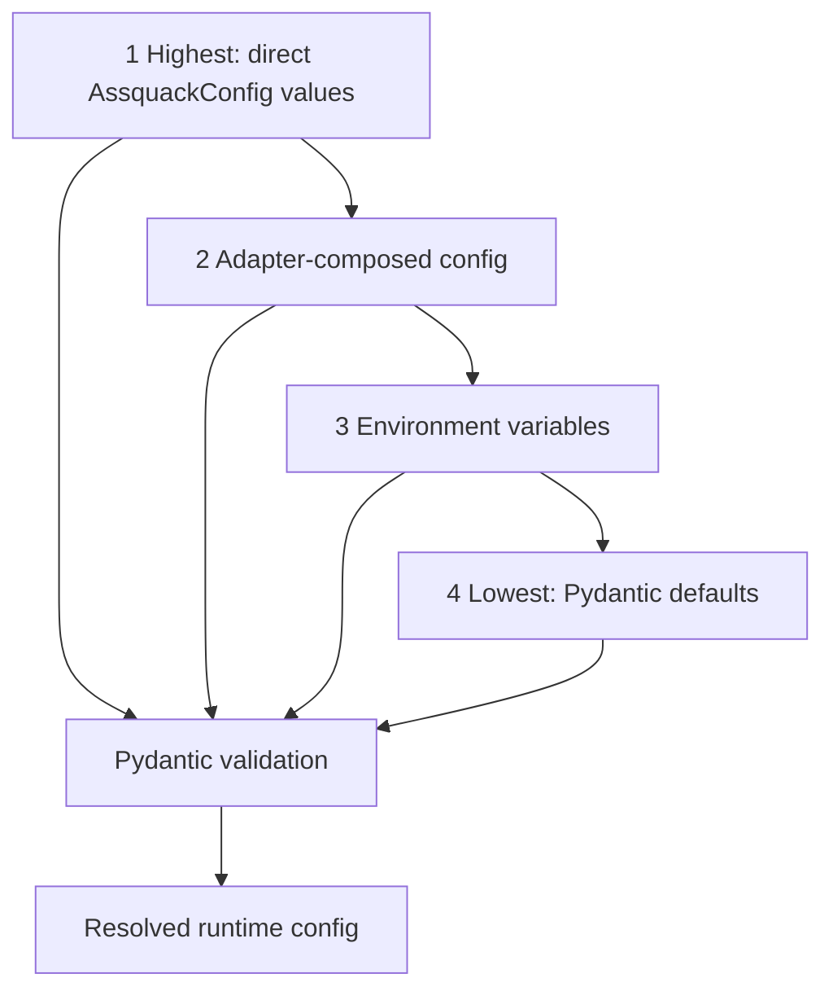

# Configuration

Assquack configuration is owned by a Pydantic model. Environment variables,
Hydra YAML, tests, and embedding runtimes are inputs to that model; they are not
separate sources of configuration truth.

The goal is for the same `AssquackConfig` contract to work in local scripts,
CI, notebooks, services, and orchestrated jobs without making Assquack depend on
any runtime framework.

## Canonical Model

`AssquackConfig` should be the only authoritative place for defaults, field
names, type coercion, and validation. Callers may construct it directly, load it
from environment variables, or ask an optional adapter to translate another
configuration system into the Pydantic shape.

Recommended top-level shape:

```text
AssquackConfig
  home
  environment
  database_path
  ingestion
    fragment_directory
    fragment_target_mb
  schema
    replace
  duckdb
    threads
    memory_limit
    temp_directory
    extensions
  exports
    enabled
    base_uri
    default_format
    snapshot_runs
    options
    azure_auth
    azure_chain
    azure_account_name
```

Configuration precedence should be explicit and predictable:



1. Values passed directly to `AssquackConfig`.
2. Values loaded by an adapter and then validated by `AssquackConfig`.
3. Environment variables consumed by the Pydantic settings model.
4. Pydantic defaults.

Hydra composition can decide which YAML files to load, but the result must still
be validated by Pydantic before Assquack uses it.

## Core Paths

`ASSQUACK_HOME` is the base local directory for Assquack runtime state. When it
is not set, Assquack uses the process's current working directory:

```text
.
```

`ENVIRONMENT` names the runtime environment and is part of the default storage
layout. Its default is:

```text
dev
```

The default database path is derived from those values:

```text
${ASSQUACK_HOME:-.}/${ENVIRONMENT:-dev}/assquack.duckdb
```

For example, with no environment overrides:

```text
<current-working-directory>/dev/assquack.duckdb
```

`database_path` is configuration-level state. It is not an asset decorator
argument, and asset authors should not choose database placement for the common
case. Multiple database files can be introduced later through configuration, but
the MVP should keep one resolved database path per configured Assquack runtime.

The default fragment directory is `<database-directory>/fragments`. It stays
local and does not follow the asset's export destination.

## Local Storage Defaults

The local profile should be usable without cloud credentials or external
services. Recommended defaults:

```yaml
assquack:
  home: ${oc.env:ASSQUACK_HOME,.}
  environment: ${oc.env:ENVIRONMENT,dev}
  database_path: ${assquack.home}/${assquack.environment}/assquack.duckdb
  ingestion:
    fragment_directory: ${assquack.home}/${assquack.environment}/fragments
    fragment_target_mb: 64
  duckdb:
    threads: 4
    memory_limit: 8GB
    temp_directory: ${oc.env:DUCKDB_TEMP_DIRECTORY,${assquack.home}/tmp}
    extensions:
      - json
      - parquet
  exports:
    enabled: false
    base_uri: ${assquack.home}/${assquack.environment}/exports
    default_format: parquet
```

The parent directories for `database_path`, `ingestion.fragment_directory`,
`duckdb.temp_directory`, and any local export base must be writable by the
process before materialization starts. Assquack may create child directories
when safe, but it should fail clearly when the configured filesystem is missing
or read-only.

## Local Ingestion Fragments

`ingestion.fragment_directory` controls the local filesystem root for NDJSON
working fragments. It defaults beside the DuckDB database and is independent of
export aliases and export base URIs.

`ingestion.fragment_target_mb` defaults to `64.0` decimal megabytes:
**1 MB = 1,000,000 bytes**, not MiB. The 64 MB target avoids tiny files without
requiring an entire fragment in memory. Positive finite fractional values are
accepted; a fractional byte target is rounded up to the next byte. Zero, negative,
NaN, and infinite values are rejected.

The writer counts the actual serialized UTF-8 NDJSON bytes, including each LF
newline. It finishes the current record before closing a fragment at or above
the target. A large record can exceed the target and remains intact. Empty input
creates no fragments, and exact-boundary completion creates no empty trailing
file. Fragments are uncompressed.

This replaces `ingestion.fragment_max_rows`; update existing configuration and
its old environment variable. It is separate from `chunk_size`: chunk size bounds
Python normalization memory, while fragment size controls the files DuckDB scans.
Yield and chunk boundaries do not force fragment boundaries.

Apply a different target to an asset through the existing per-call override:

```python
from assquack import AssquackConfig, IngestionConfig

config = AssquackConfig(ingestion=IngestionConfig(fragment_target_mb=32))
result = await orders(assquack_config=config)
```

Environment overrides are
`ASSQUACK_INGESTION__FRAGMENT_DIRECTORY` and
`ASSQUACK_INGESTION__FRAGMENT_TARGET_MB`.

## Replacement Schema

`schema.replace` defaults to `"current_run"`, the only supported value. It selects
the current-run schema strategy: infer from this extraction's completed fragments
without retaining prior columns or types. Unsupported values such as
`"continuation"` fail configuration validation. The environment override is
`ASSQUACK_SCHEMA__REPLACE`.

Apply this configuration through the existing per-call override:

```python
from assquack import AssquackConfig, SchemaConfig

config = AssquackConfig(schema=SchemaConfig(replace="current_run"))
result = await orders(assquack_config=config)
```

Read the setting as `config.schema.replace`. Internally, the Pydantic field is
`schema_settings`, aliased to `schema` to avoid colliding with Pydantic's legacy
`schema()` method. Use `model_dump(by_alias=True)` for the external config shape.
The asset decorator and its `mode="replace"` string remain unchanged.

An empty extraction publishes an empty table with only run metadata columns.
See [Schema Inference](schema-inference.md) for column removal and type behavior.

## DuckDB Settings

DuckDB settings belong under `assquack.duckdb`.

`threads` controls DuckDB execution parallelism and maps to DuckDB's `threads`
setting when a connection is opened.

`memory_limit` controls DuckDB's memory cap and maps to DuckDB's `memory_limit`
setting. It should accept DuckDB-compatible strings such as `8GB`.

`temp_directory` controls where DuckDB writes temporary spill files. It should
default from `DUCKDB_TEMP_DIRECTORY` when present, otherwise to a local path
under `ASSQUACK_HOME`. The runtime must ensure this directory is writable and
has sufficient capacity for the largest expected materialization.

`extensions` lists already installed DuckDB extensions Assquack loads during
connection setup. Assquack does not install extensions. The local MVP profile should include `json` and `parquet`.
Azure exports load `azure` on demand; listing it here is optional. Source and sink
integrations such as `postgres` are optional extensions, not core storage
requirements.

Connection setup should be deterministic:

1. Resolve and validate `AssquackConfig`.
2. Ensure local directories exist or fail with a clear error.
3. Open DuckDB at the resolved `database_path`.
4. Apply `threads`, `memory_limit`, and `temp_directory`.
5. Load configured extensions (provision them separately).
6. Bootstrap Assquack system schemas and tables.

## Exports

Exports are configured compatibility artifacts. They are not the source of truth
for an asset; the current DuckDB table and Assquack system metadata are.

Recommended export fields:

- `enabled`: whether successful materializations write compatibility artifacts;
- `base_uri`: the base for resolving `mad://...` export aliases;
- `default_format`: `parquet` by default;
- `snapshot_runs`: whether to retain run-specific export snapshots in addition
  to the current compatibility target;
- `options`: format-specific write options passed to DuckDB export statements.

Local development can use a filesystem `base_uri`, such as:

```text
${ASSQUACK_HOME}/${ENVIRONMENT}/exports
```

ADLS deployments can use an ABFSS base URI:

```text
abfss://lake/exports/assquack
```

When exports are enabled, relative decorator paths and `mad://...` aliases
resolve under `exports.base_uri`. Export paths do not choose the DuckDB database
file, schema, or table.

## ADLS Credentials

Azure exports register a temporary DuckDB secret on the connection performing
`COPY`. Both automatic asset exports and explicit `result.export_parquet(...)`
use this path. Local exports do not read SAS variables or register Azure secrets.
Install the matching DuckDB `azure` extension in the deployment before use; the
writer executes `LOAD azure` and never installs it itself. Listing `azure` in
`duckdb.extensions` is optional for exports. Configured extensions also load on
ordinary database opens.

### Authentication Configuration

The complete public authentication configuration is under `ExportsConfig`:

| Field | Default | Environment override | Meaning |
| --- | --- | --- | --- |
| `azure_auth` | `"auto"` | `ASSQUACK_EXPORTS__AZURE_AUTH` | Select `auto`, `credential_chain`, or `sas`. |
| `azure_chain` | `None` | `ASSQUACK_EXPORTS__AZURE_CHAIN` | For credential-chain auth, omit `CHAIN` for SDK discovery or select one of `cli`, `env`, `managed_identity`, `workload_identity`, `default`. |
| `azure_account_name` | `None` | `ASSQUACK_EXPORTS__AZURE_ACCOUNT_NAME` | Account for short URIs under credential-chain auth; 3 to 24 lowercase letters or digits. If also set for SAS, it must match the provider account. |

Direct config values override process environment config settings. `azure_chain`
accepts one method, not a semicolon-separated chain. `enabled` controls automatic
exports; `base_uri` resolves relative and `mad://` aliases. Explicit
`result.export_parquet(path)` uses the authentication configuration even when
automatic exports are disabled. `default_format` remains `parquet`; `options`
and `snapshot_runs` remain reserved settings not applied by this writer.

### SAS Credential Provider And Selection

The environment credential provider supplies the explicit SAS pair at export
time. The token is not a field of `ExportsConfig`:

| Process variable | Value |
| --- | --- |
| `AZURE_STORAGE_SAS_TOKEN` | Encoded SAS query token, optionally starting with `?`; supply the token rather than a full signed URL or connection string. |
| `AZURE_STORAGE_ACCOUNT_NAME` | Account belonging to that SAS token; 3 to 24 lowercase letters or digits. |

Surrounding whitespace is trimmed. Unset, empty and whitespace-only values count
as absent. With `azure_auth="auto"`, a complete pair selects SAS, neither selects
native credential discovery, and an incomplete pair raises `ConfigurationError`.
An invalid complete pair fails validation; it never silently falls back to native
authentication. Neither a fully qualified URI nor `azure_account_name` substitutes
for the provider's required account variable.

Explicit overrides are deterministic:

- `azure_auth="credential_chain"` never reads either SAS variable, even if they
  are present, partial or invalid.
- `azure_auth="sas"` requires the complete provider pair.
- Explicit SAS with `azure_chain` fails config validation. Automatic selection
  of SAS with `azure_chain` fails at export time: remove the chain selection or
  explicitly choose `credential_chain`. A selected chain is never ignored.
- The provider account, optional configured account and fully qualified URI
  account must agree when SAS is selected.

```python
from assquack import AssquackConfig, ExportsConfig

config = AssquackConfig(
    exports=ExportsConfig(
        enabled=True,
        base_uri="abfss://exampleaccount.dfs.core.windows.net/lake/exports",
        azure_auth="credential_chain",  # Ignore any explicit SAS environment pair.
        azure_chain="workload_identity",
    ),
)
```

For SAS, the deployment injects the two process variables and uses `auto` or
`sas`. The application can construct configuration before credential injection;
credentials are resolved when each Azure export runs. No `.env` files are loaded.
Only these explicit SAS variables are read by Assquack. Native identity variables,
managed identity and Azure CLI discovery remain entirely owned by DuckDB's SDK.

### Native Secrets And Supported Paths

Native credential discovery registers `TYPE azure, PROVIDER credential_chain`,
optionally with `CHAIN` and `ACCOUNT_NAME`. SAS registers `TYPE azure, PROVIDER
config` with a bound connection-string value equivalent to:

```text
AccountName=exampleaccount;BlobEndpoint=https://exampleaccount.blob.core.windows.net;SharedAccessSignature=<encoded SAS token>
```

The SDK derives the HTTPS DFS endpoint from `AccountName`, so SAS supports both
Blob (`az://`, `azure://`) and ADLS (`abfss://`) paths. This MVP targets Azure
public-cloud endpoints. Short paths such as `abfss://lake/exports/orders.parquet`
use the selected account. Fully qualified paths use
`abfss://exampleaccount.dfs.core.windows.net/lake/exports/orders.parquet` or
`az://exampleaccount.blob.core.windows.net/lake/exports/orders.parquet`.
Hadoop `filesystem@account` paths and signed URI query strings are not accepted.
Keep SAS tokens in the provider, never in a decorator or export URI.

The token retains its URL encoding. Raw semicolons, control characters, blank
signatures and full URLs are rejected before registration. Account validation
and bound SQL values prevent connection-string field and SQL injection. SAS
backend errors are replaced with safe messages and their printed exception
context is suppressed because SDK diagnostics can include signed URLs.

Each secret uses a unique name and directory scope ending in `/`, and is dropped
after COPY, including failure. The connection closes afterward. The token stays
out of public config representations and Assquack's durable metadata; it is held
only in memory for the temporary DuckDB secret and SDK use.

Credential providers supply validated explicit credentials; authentication
strategies register the corresponding DuckDB secret. These are small internal
boundaries, inspired by Quackframe's separation, without a Quackframe dependency.
No Prefect, fsspec, block adapter, arbitrary connection-string input or account-key
authentication is implemented. Each downstream deployment owns credential injection.

Verification is offline: synthetic credentials, SQL parsing, connection routing,
redaction and failure handling. No real Azure authentication or writes are claimed.
See [DuckDB authentication](https://duckdb.org/docs/current/core_extensions/azure#authentication),
[Microsoft SAS connection strings](https://learn.microsoft.com/en-us/azure/storage/common/storage-configure-connection-string#create-a-connection-string-using-a-shared-access-signature),
and the [22 October scope amendment](journal/2026-09-08-mvp-scope.md#6-native-export-path-and-aliases).

## Hydra Adapter

Hydra support is an optional adapter over the Pydantic model. It should live at
the edge of the library, for projects that already use Hydra composition.

Suggested groups:

```text
conf/assquack/default.yaml
conf/assquack/storage/local.yaml
conf/assquack/storage/adls_export.yaml
conf/assquack/duckdb/local.yaml
```

Example ADLS export profile:

```yaml
assquack:
  home: ${oc.env:ASSQUACK_HOME,.}
  environment: ${oc.env:ENVIRONMENT,dev}
  database_path: ${assquack.home}/${assquack.environment}/assquack.duckdb
  ingestion:
    fragment_directory: ${assquack.home}/${assquack.environment}/fragments
    fragment_target_mb: 64
  duckdb:
    threads: 4
    memory_limit: 8GB
    temp_directory: ${oc.env:DUCKDB_TEMP_DIRECTORY,${assquack.home}/tmp}
    extensions:
      - json
      - parquet
      - azure
  exports:
    enabled: true
    base_uri: abfss://exampleaccount.dfs.core.windows.net/lake/exports/assquack
    default_format: parquet
```

The adapter's responsibility is narrow:

1. Compose Hydra config.
2. Resolve interpolations such as `ASSQUACK_HOME` and `ENVIRONMENT`.
3. Convert the `assquack` node to plain Python data.
4. Construct and return `AssquackConfig`.

Hydra must not define behavior that Pydantic does not know about. If a field is
needed by Assquack, add it to the Pydantic model first.

## Runtime Responsibilities

The embedding runtime is responsible for the operating environment:

- run from a writable current working directory or provide a writable
  `ASSQUACK_HOME` override;
- provide enough disk capacity for the DuckDB database and temp spill files;
- provide enough local disk capacity for bounded NDJSON working fragments;
- set `ASSQUACK_HOME` when the current working directory is not suitable;
- set `ENVIRONMENT` so dev, test, and prod do not share the same database path;
- optionally set `DUCKDB_TEMP_DIRECTORY` for larger or faster temporary storage;
- provide ADLS credentials through environment variables or DuckDB secrets;
- add external concurrency controls if the runtime needs them.

Assquack itself should enforce one writer per resolved DuckDB database path.
Embedding runtimes can run Assquack by supplying the same Pydantic
configuration inputs as any other Python runtime.

## Related Docs

- [Storage Model](storage-model.md): how `database_path` maps to DuckDB state.
- [Exports](exports.md): how export base URI and ADLS credentials are used.
- [Developer API](developer-api.md): which concerns stay out of the decorator
  and belong in configuration.
- [Overview](overview.md): the framework-agnostic design stance.
- [Roadmap](roadmap.md): configuration work in the MVP phases.
