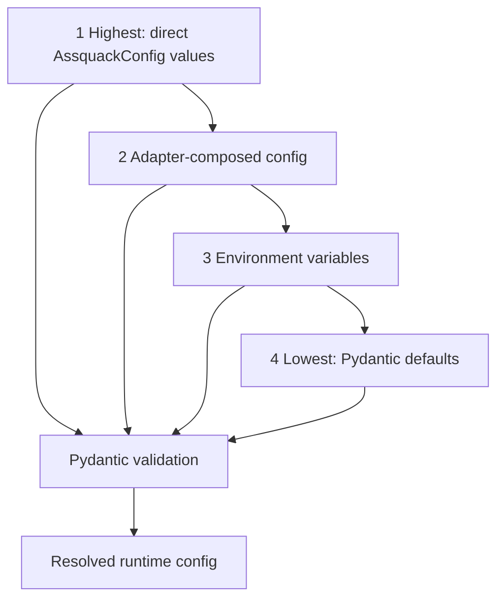

# Configuration

Assquack configuration is owned by a Pydantic model. Environment variables,
Hydra YAML, tests, and embedding runtimes are inputs to that model; they are not
separate sources of configuration truth.

The goal is for the same `AssquackConfig` contract to work in local scripts,
CI, notebooks, services, and orchestrated jobs without making Assquack depend on
any runtime framework.

## Canonical Model

`AssquackConfig` should be the only authoritative place for defaults, field
names, type coercion, and validation. Callers may construct it directly, load it
from environment variables, or ask an optional adapter to translate another
configuration system into the Pydantic shape.

Recommended top-level shape:

```text
AssquackConfig
  home
  environment
  database_path
  ingestion
    fragment_directory
    fragment_target_mb
  schema
    replace
  duckdb
    threads
    memory_limit
    temp_directory
    extensions
  exports: one destination or a list (default [])
    base_uri
    auth
```

Configuration precedence should be explicit and predictable:



1. Values passed directly to `AssquackConfig`.
2. Values loaded by an adapter and then validated by `AssquackConfig`.
3. Environment variables consumed by the Pydantic settings model.
4. Pydantic defaults.

Hydra composition can decide which YAML files to load, but the result must still
be validated by Pydantic before Assquack uses it.

## Core Paths

`ASSQUACK_HOME` is the base local directory for Assquack runtime state. When it
is not set, Assquack uses the process's current working directory:

```text
.
```

`ENVIRONMENT` names the runtime environment and is part of the default storage
layout. Its default is:

```text
dev
```

The default database path is derived from those values:

```text
${ASSQUACK_HOME:-.}/${ENVIRONMENT:-dev}/assquack.duckdb
```

For example, with no environment overrides:

```text
<current-working-directory>/dev/assquack.duckdb
```

`database_path` is configuration-level state. It is not an asset decorator
argument, and asset authors should not choose database placement for the common
case. Multiple database files can be introduced later through configuration, but
the MVP should keep one resolved database path per configured Assquack runtime.

The default fragment directory is `<database-directory>/fragments`. It stays
local and does not follow the asset's export destination.

## Local Storage Defaults

The local profile should be usable without cloud credentials or external
services. Recommended defaults:

```yaml
assquack:
  home: ${oc.env:ASSQUACK_HOME,.}
  environment: ${oc.env:ENVIRONMENT,dev}
  database_path: ${assquack.home}/${assquack.environment}/assquack.duckdb
  ingestion:
    fragment_directory: ${assquack.home}/${assquack.environment}/fragments
    fragment_target_mb: 64
  duckdb:
    threads: 4
    memory_limit: 8GB
    temp_directory: ${oc.env:DUCKDB_TEMP_DIRECTORY,${assquack.home}/tmp}
    extensions:
      - json
      - parquet
  exports:
    base_uri: ${assquack.home}/${assquack.environment}/exports
```

The parent directories for `database_path`, `ingestion.fragment_directory`,
`duckdb.temp_directory`, and any local export base must be writable by the
process before materialization starts. Assquack may create child directories
when safe, but it should fail clearly when the configured filesystem is missing
or read-only.

## Local Ingestion Fragments

`ingestion.fragment_directory` controls the local filesystem root for NDJSON
working fragments. It defaults beside the DuckDB database and is independent of
export aliases and export base URIs.

`ingestion.fragment_target_mb` defaults to `64.0` decimal megabytes:
**1 MB = 1,000,000 bytes**, not MiB. The 64 MB target avoids tiny files without
requiring an entire fragment in memory. Positive finite fractional values are
accepted; a fractional byte target is rounded up to the next byte. Zero, negative,
NaN, and infinite values are rejected.

The writer counts the actual serialized UTF-8 NDJSON bytes, including each LF
newline. It finishes the current record before closing a fragment at or above
the target. A large record can exceed the target and remains intact. Empty input
creates no fragments, and exact-boundary completion creates no empty trailing
file. Fragments are uncompressed.

This replaces `ingestion.fragment_max_rows`; update existing configuration and
its old environment variable. It is separate from `chunk_size`: chunk size bounds
Python normalization memory, while fragment size controls the files DuckDB scans.
Yield and chunk boundaries do not force fragment boundaries.

Apply a different target to an asset through the existing per-call override:

```python
from assquack import AssquackConfig, IngestionConfig

config = AssquackConfig(ingestion=IngestionConfig(fragment_target_mb=32))
result = await orders(assquack_config=config)
```

Environment overrides are
`ASSQUACK_INGESTION__FRAGMENT_DIRECTORY` and
`ASSQUACK_INGESTION__FRAGMENT_TARGET_MB`.

## Replacement Schema

`schema.replace` defaults to `"current_run"`, the only supported value. It selects
the current-run schema strategy: infer from this extraction's completed fragments
without retaining prior columns or types. Unsupported values such as
`"continuation"` fail configuration validation. The environment override is
`ASSQUACK_SCHEMA__REPLACE`.

Apply this configuration through the existing per-call override:

```python
from assquack import AssquackConfig, SchemaConfig

config = AssquackConfig(schema=SchemaConfig(replace="current_run"))
result = await orders(assquack_config=config)
```

Read the setting as `config.schema.replace`. Internally, the Pydantic field is
`schema_settings`, aliased to `schema` to avoid colliding with Pydantic's legacy
`schema()` method. Use `model_dump(by_alias=True)` for the external config shape.
The asset decorator and its `mode="replace"` string remain unchanged.

An empty extraction publishes an empty table with only run metadata columns.
See [Schema Inference](schema-inference.md) for column removal and type behavior.

## DuckDB Settings

DuckDB settings belong under `assquack.duckdb`.

`threads` controls DuckDB execution parallelism and maps to DuckDB's `threads`
setting when a connection is opened.

`memory_limit` controls DuckDB's memory cap and maps to DuckDB's `memory_limit`
setting. It should accept DuckDB-compatible strings such as `8GB`.

`temp_directory` controls where DuckDB writes temporary spill files. It should
default from `DUCKDB_TEMP_DIRECTORY` when present, otherwise to a local path
under `ASSQUACK_HOME`. The runtime must ensure this directory is writable and
has sufficient capacity for the largest expected materialization.

`extensions` lists already installed DuckDB extensions Assquack loads during
connection setup. Assquack does not install extensions. The local MVP profile should include `json` and `parquet`.
Azure exports load `azure` on demand; listing it here is optional. Source and sink
integrations such as `postgres` are optional extensions, not core storage
requirements.

Connection setup should be deterministic:

1. Resolve and validate `AssquackConfig`.
2. Ensure local directories exist or fail with a clear error.
3. Open DuckDB at the resolved `database_path`.
4. Apply `threads`, `memory_limit`, and `temp_directory`.
5. Load configured extensions (provision them separately).
6. Bootstrap Assquack system schemas and tables.

## Exports

`AssquackConfig.exports` accepts one `ExportDestination` or a list, normalized to
an ordered list. The default is `[]`: no automatic exports, even when an asset
has an export declaration. This does not prevent materialization or cache hits.
The supplied destination is `FileSystemDestination(base_uri, auth)`, constructed
with keyword arguments. `base_uri` is required; `auth` defaults to `"auto"`.
Formats belong to asset declarations, not destinations.

```python
from assquack import AssquackConfig, FileSystemDestination

config = AssquackConfig(
    exports=[
        FileSystemDestination(base_uri="./exports"),
        FileSystemDestination(
            base_uri="abfss://exampleaccount.dfs.core.windows.net/lake/exports",
            auth="credential_chain",
        ),
    ],
)
result = await orders(assquack_config=config)
```

Each destination resolves the same declaration. All pipe formats are written to
the first destination before moving to the next. Relative and `mad://` aliases
resolve under that destination's base; absolute paths and concrete URIs keep their
location. Resolution freezes the actual write path before cache lookup or writing.
The operation rejects the same resolved write path with different destination
fingerprints; repeated identical configurations are allowed. See
[Exports](exports.md) for credential capture, lifetime, and fingerprint semantics.

Set `ASSQUACK_EXPORTS` to a JSON object or list using `base_uri` and `auth`:

```json
[{"base_uri": "./exports", "auth": "auto"}]
```

Direct values override this environment variable; `exports=[]` explicitly
disables automatic exports. Mapping inputs construct filesystem destinations.
Custom destination types are supplied as Python `ExportDestination` instances.
`model_dump(by_alias=True)` preserves concrete destination fields. JSON schema
includes the filesystem mapping. No `.env` files are loaded.

`ExportsConfig` and its earlier `ASSQUACK_EXPORTS__*` variables are removed.
Replace them with destination objects or `ASSQUACK_EXPORTS`; old environment
variables are not interpreted. There are no `enabled`, `default_format`,
`snapshot_runs`, `options`, writer or adapter selectors. Unknown destination
fields fail validation. Snapshots and custom COPY options remain unsupported.

`result.export_parquet(path=None)` explicitly exports even with `exports=[]`.
It uses every configured destination, or a filesystem destination based at
`<home>/<environment>/exports` with automatic authentication when none is
configured. It returns one URI string for one output and an ordered list of URI
strings for multiple outputs. A concrete path with multiple destinations can
collide and is rejected; use relative paths to address each base. The convenience
method requests Parquet only and rejects pipe syntax or conflicting suffixes.

## ADLS Credentials

Azure exports load the already installed DuckDB `azure` extension and register a
temporary secret on the connection performing COPY. Assquack never installs the
extension. Local exports neither load Azure nor retrieve Azure credentials.

### Authentication Configuration

The `auth` field selects a registered compatible authenticator:

| Destination | Choice | Behavior |
| --- | --- | --- |
| Local/file | `auto` or `none` | No authentication or credential loading. |
| Azure | `auto` | Complete SAS pair selects SAS; absent pair selects the validated environment credential chain; partial or invalid pair fails. |
| Azure | `sas` | Require a complete valid SAS pair. |
| Azure | `credential_chain` | Load and fingerprint supported environment inputs; require one complete method. |

Unknown or incompatible choices fail when the destination is used. Registry
instances are isolated per destination and reject duplicate registrations.
The destination's public fields remain `base_uri` and `auth`; the earlier
`azure_chain` and `azure_account_name` settings are not retained. The chain is restricted to supported environment-based methods. Use a fully qualified URI for
credential-chain authentication. SAS can supply the account for a short URI.

### SAS Credential Provider And Selection

During `FileSystemDestination.resolve()`, the environment provider reads each
required value once for the operation, before cache lookup:

| Process variable | Value |
| --- | --- |
| `AZURE_STORAGE_SAS_TOKEN` | Encoded SAS query token, optionally starting with `?`; never a full signed URL or connection string. |
| `AZURE_STORAGE_ACCOUNT_NAME` | Account belonging to the token; 3 to 24 lowercase letters or digits. |

Surrounding whitespace is trimmed. Empty and whitespace-only values count as
absent. A URI account never substitutes for the provider's required account.
A fully qualified URI must match the SAS account. Invalid credentials fail with
safe messages rather than falling back to native discovery. Tokens retain URL
encoding; raw semicolons, control characters, blank signatures and URLs are rejected.

Providers implement internal asynchronous `load()` followed by synchronous
`get(name)`. Each destination has an internal provider-instance injection point;
it defaults to environment sourcing. Synchronous destination resolution runs loading
to completion, using a worker thread with its own event loop if the caller
already has an active loop. Providers must load on that loop rather than depend
on tasks bound to the caller's loop. Local exports skip both loading and lookup. Credential-chain exports load the
provider and capture the supported environment inputs. No public provider argument
or provider registry is supplied.
Private providers are excluded from config serialization and representations.

### Credential-Chain Environment Inputs

`resolve()` loads the provider once and captures the values present for
`AZURE_TENANT_ID`, `AZURE_CLIENT_ID`, `AZURE_CLIENT_SECRET`,
`AZURE_CLIENT_CERTIFICATE_PATH`, `AZURE_AUTHORITY_HOST`, and
`AZURE_FEDERATED_TOKEN_FILE`. Those values enter the destination fingerprint;
raw values are never written to asset metadata.

Tenant ID and client ID are required alongside at least one of:

- Client secret: selects `env`.
- Client certificate path: selects `env`.
- Federated token-file path: selects `workload_identity`.

When both environment and workload methods are configured, DuckDB receives
`CHAIN 'env;workload_identity'`. Within `env`, the Azure SDK prefers a client
secret over a certificate. Authority host is optional. Missing inputs raise a
configuration error before export; CLI and managed-identity fallback are disabled.
The deployment supplies these same settings to DuckDB's process environment.
The provider snapshot identifies the configuration; DuckDB still reads its
runtime environment and obtains tokens when executing the export. No process
variables are rewritten, and certificate/token files are not read for fingerprinting.

### Native Secrets And Supported Paths

Credential-chain authentication registers `TYPE azure, PROVIDER credential_chain`.
SAS registers `TYPE azure, PROVIDER config` with a bound connection string:

```text
AccountName=exampleaccount;BlobEndpoint=https://exampleaccount.blob.core.windows.net;SharedAccessSignature=<encoded SAS token>
```

Supported schemes are `az`, `azure` and `abfss`. Fully qualified paths use
`abfss://exampleaccount.dfs.core.windows.net/lake/exports/orders.parquet` or
`az://exampleaccount.blob.core.windows.net/lake/exports/orders.parquet`.
Short SAS paths such as `abfss://lake/exports/orders.parquet` use the provider
account. Only public-cloud endpoints are supported. Hadoop `filesystem@account`
paths and signed URI query strings are rejected. Keep credentials out of URIs.

Each secret has a unique name and directory scope ending in `/`. It is dropped
after COPY, including failure. Cleanup failure propagates a safe error; cleanup
failure during an existing error is logged safely and does not expose backend
diagnostics. Provider, extension-load and authentication errors suppress their
potentially sensitive printed exception context. The connection closes afterward.
No success manifest is recorded for a failed export or failed cleanup.

Verification is offline with synthetic credentials and intercepted Azure SQL;
no real Azure authentication, writes or automatic ADLS parent creation are claimed.
Containers and required ADLS directories must be provisioned by the deployment.
See [Exports](exports.md) for publication limitations and manifest semantics.

## Hydra Adapter

Hydra support is an optional adapter over the Pydantic model. It should live at
the edge of the library, for projects that already use Hydra composition.

Suggested groups:

```text
conf/assquack/default.yaml
conf/assquack/storage/local.yaml
conf/assquack/storage/adls_export.yaml
conf/assquack/duckdb/local.yaml
```

Example ADLS export profile:

```yaml
assquack:
  home: ${oc.env:ASSQUACK_HOME,.}
  environment: ${oc.env:ENVIRONMENT,dev}
  database_path: ${assquack.home}/${assquack.environment}/assquack.duckdb
  ingestion:
    fragment_directory: ${assquack.home}/${assquack.environment}/fragments
    fragment_target_mb: 64
  duckdb:
    threads: 4
    memory_limit: 8GB
    temp_directory: ${oc.env:DUCKDB_TEMP_DIRECTORY,${assquack.home}/tmp}
    extensions:
      - json
      - parquet
      - azure
  exports:
    base_uri: abfss://exampleaccount.dfs.core.windows.net/lake/exports/assquack
```

The adapter's responsibility is narrow:

1. Compose Hydra config.
2. Resolve interpolations such as `ASSQUACK_HOME` and `ENVIRONMENT`.
3. Convert the `assquack` node to plain Python data.
4. Construct and return `AssquackConfig`.

Hydra must not define behavior that Pydantic does not know about. If a field is
needed by Assquack, add it to the Pydantic model first.

## Runtime Responsibilities

The embedding runtime is responsible for the operating environment:

- run from a writable current working directory or provide a writable
  `ASSQUACK_HOME` override;
- provide enough disk capacity for the DuckDB database and temp spill files;
- provide enough local disk capacity for bounded NDJSON working fragments;
- set `ASSQUACK_HOME` when the current working directory is not suitable;
- set `ENVIRONMENT` so dev, test, and prod do not share the same database path;
- optionally set `DUCKDB_TEMP_DIRECTORY` for larger or faster temporary storage;
- provide ADLS credentials through environment variables or DuckDB secrets;
- add external concurrency controls if the runtime needs them.

Assquack itself should enforce one writer per resolved DuckDB database path.
Embedding runtimes can run Assquack by supplying the same Pydantic
configuration inputs as any other Python runtime.

## Related Docs

- [Storage Model](storage-model.md): how `database_path` maps to DuckDB state.
- [Exports](exports.md): how export base URI and ADLS credentials are used.
- [Developer API](developer-api.md): which concerns stay out of the decorator
  and belong in configuration.
- [Overview](overview.md): the framework-agnostic design stance.
- [Roadmap](roadmap.md): configuration work in the MVP phases.
