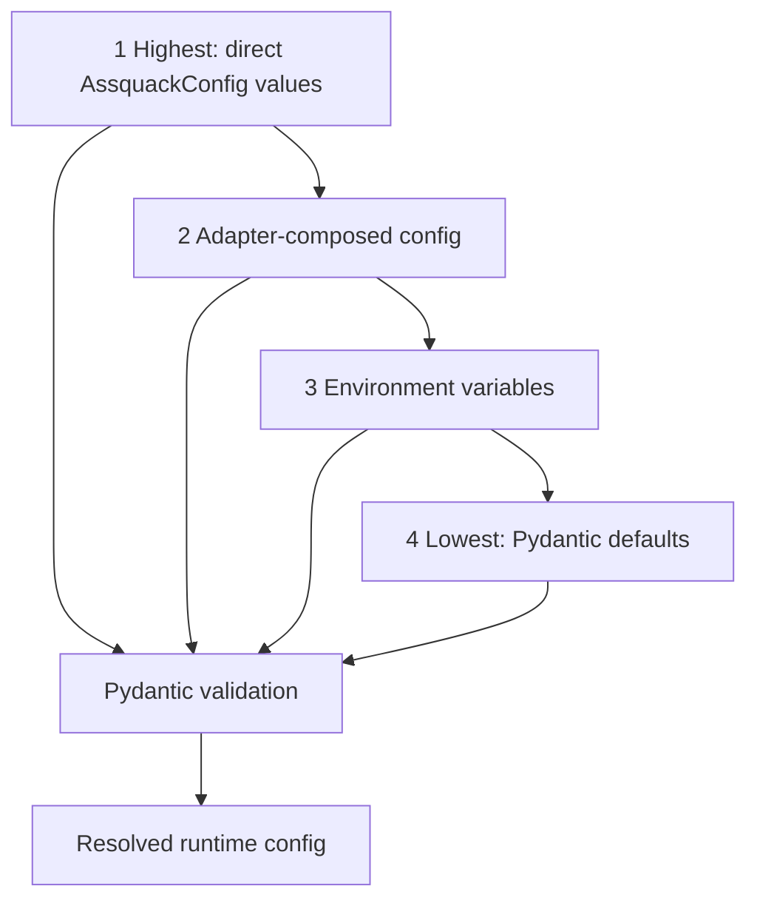

# Configuration

Assquack configuration is owned by a Pydantic model. Environment variables,
Hydra YAML, tests, and embedding runtimes are inputs to that model; they are not
separate sources of configuration truth.

The goal is for the same `AssquackConfig` contract to work in local scripts,
CI, notebooks, services, and orchestrated jobs without making Assquack depend on
any runtime framework.

## Canonical Model

`AssquackConfig` should be the only authoritative place for defaults, field
names, type coercion, and validation. Callers may construct it directly, load it
from environment variables, or ask an optional adapter to translate another
configuration system into the Pydantic shape.

Recommended top-level shape:

```text
AssquackConfig
  home
  database_path
  ingestion
    fragment_directory
    fragment_target_mb
  schema
    replace
  duckdb
    threads
    memory_limit
    temp_directory
    extensions
  exports: one destination or null (default null)
    base_uri
    auth
```

Configuration precedence should be explicit and predictable:



1. Values passed directly to `AssquackConfig`.
2. Values loaded by an adapter and then validated by `AssquackConfig`.
3. Environment variables consumed by the Pydantic settings model.
4. Pydantic defaults.

Hydra composition can decide which YAML files to load, but the result must still
be validated by Pydantic before Assquack uses it.

## Attaching configuration to assets

Use `@asset("sales.orders", config=config)` to attach a project config, or
`orders.with_options(config=other_config)` for an independent asset copy.
Execution, asset queries and existence checks select the explicit
`assquack_config` call override, then the attached config, then ordinary
`AssquackConfig()` defaults. Objects are selected whole, not merged or deep-copied.
Selection happens when execution starts. Change shared configuration before
execution or between invocations, not while an invocation is running.
See [asset option copies](developer-api.md#asset-config-and-option-copies)
for resets, chaining and dependency behavior.

## Core Paths

General queries use `duckdb.query` directly. DuckDB owns table and function-name
resolution through its default database and search path, regardless of how many
databases are attached. See the [query contract](developer-api.md#general-database-queries).

Setting `ASSQUACK_HOME` or `ASSQUACK_DATABASE_PATH` in the process environment
before `import assquack` requests database initialization at import. Assquack
opens or creates the file, initializes its metadata, and selects it as DuckDB's
default so `duckdb.query` works immediately. Presence of either variable is the
trigger, including an empty value; set a concrete path for predictable placement.
`ASSQUACK_ATTACHMENT_NAME`, DuckDB resource settings, ingestion settings and
exports alone do not trigger initialization. Without a placement variable,
import leaves DuckDB's in-memory default and creates no Assquack disk database.
No `.env` file is read.

```python
# Set ASSQUACK_HOME or ASSQUACK_DATABASE_PATH in the process before this import.
import assquack
import duckdb

rows = duckdb.query("SELECT count(*) FROM assquack_meta.assets")
```

`ASSQUACK_HOME` is the base local directory for Assquack runtime state. When it
is not set, Assquack uses the process's current working directory:

```text
.
```

The default database path is derived from home:

```text
${ASSQUACK_HOME:-.}/assquack.duckdb
```

For example, with no environment overrides:

```text
<current-working-directory>/assquack.duckdb
```

`database_path` is configuration-level state. It is not an asset decorator
argument, and asset authors should not choose database placement for the common
case. Each config resolves one database path as its write destination. Multiple
configs can attach their databases under distinct names on the shared engine.

The default fragment directory is `<database-directory>/fragments`. It stays
local and does not follow the asset's export destination.

## Local Storage Defaults

The local profile should be usable without cloud credentials or external
services. Recommended defaults:

```yaml
assquack:
  home: ${oc.env:ASSQUACK_HOME,.}
  database_path: ${assquack.home}/assquack.duckdb
  ingestion:
    fragment_directory: ${assquack.home}/fragments
    fragment_target_mb: 64
  duckdb:
    threads: 4
    memory_limit: 8GB
    temp_directory: ${oc.env:DUCKDB_TEMP_DIRECTORY,${assquack.home}/tmp}
    extensions:
      - json
      - parquet
  exports:
    base_uri: ${assquack.home}/exports
```

The parent directories for `database_path`, `ingestion.fragment_directory`,
`duckdb.temp_directory`, and any local export base must be writable by the
process before materialization starts. Assquack may create child directories
when safe, but it should fail clearly when the configured filesystem is missing
or read-only.

## Local Ingestion Fragments

`ingestion.fragment_directory` controls the local filesystem root for NDJSON
working fragments. It defaults beside the DuckDB database and is independent of
export aliases and export base URIs.

`ingestion.fragment_target_mb` defaults to `64.0` decimal megabytes:
**1 MB = 1,000,000 bytes**, not MiB. The 64 MB target avoids tiny files without
requiring an entire fragment in memory. Positive finite fractional values are
accepted; a fractional byte target is rounded up to the next byte. Zero, negative,
NaN, and infinite values are rejected.

The Python writer counts the actual serialized UTF-8 NDJSON bytes, including each LF
newline. It finishes the current record before closing a fragment at or above
the target. A large record can exceed the target and remains intact. Empty input
creates no fragments, and exact-boundary completion creates no empty trailing
file. Fragments are uncompressed.

Native relation inputs use DuckDB COPY with approximate byte targeting; files
may substantially exceed the target. Empty native output is deleted before
registration. Python inputs stream records directly.
Switching between Python and native batches can close an unfinished fragment;
all completed fragments remain nonempty and contain whole records.

Apply a different target to an asset through the existing per-call override:

```python
from assquack import AssquackConfig, IngestionConfig

config = AssquackConfig(ingestion=IngestionConfig(fragment_target_mb=32))
result = await orders(assquack_config=config)
```

Environment overrides are
`ASSQUACK_INGESTION__FRAGMENT_DIRECTORY` and
`ASSQUACK_INGESTION__FRAGMENT_TARGET_MB`.

## Replacement Schema

`schema.replace` defaults to `"current_run"`, the only supported value. It selects
the current-run schema strategy: infer from this extraction's completed fragments
without retaining prior columns or types. Unsupported values such as
`"continuation"` fail configuration validation. The environment override is
`ASSQUACK_SCHEMA__REPLACE`.

Apply this configuration through the existing per-call override:

```python
from assquack import AssquackConfig, SchemaConfig

config = AssquackConfig(schema=SchemaConfig(replace="current_run"))
result = await orders(assquack_config=config)
```

Read the setting as `config.schema.replace`. Internally, the Pydantic field is
`schema_settings`, aliased to `schema` to avoid colliding with Pydantic's legacy
`schema()` method. Use `model_dump(by_alias=True)` for the external config shape.
The asset decorator and its `mode="replace"` string remain unchanged.

An empty extraction publishes an empty table with only run metadata columns.
See [Schema Inference](schema-inference.md) for column removal and type behavior.

## Database Attachments

`AssquackConfig.attachment_name` is the public SQL catalog name, defaulting to
`assquack`. Set `ASSQUACK_ATTACHMENT_NAME` for environment-derived configuration.
Names are safely quoted; ordinary ASCII case differences identify the same name.
Use distinct names for different files. The canonical resolved file path and name
must both match on reuse: attaching another file under that name or the same file
under a different name raises a clear error.

```python
from pathlib import Path
from assquack import AssquackConfig

people = AssquackConfig(home=Path("./people"), attachment_name="people")
people.attach()  # synchronous; no-op when the same attachment already exists
```

Constructing configs and decorating assets are lazy. `config.attach()` initializes
metadata and creates a missing database; materialization, result queries and
existence checks also initialize their effective configuration on first use.
The first successful attachment becomes DuckDB's default database. Later
attachments never replace that selection, even if the application subsequently
uses native `USE` or `SET search_path`. An asset's config still selects its write
destination; it does not change the database used by general SQL inside its source.

The automatic import and explicit Python routes use the same shared DuckDB
connection. Afterwards `people.hr.employees` works in `duckdb.query()`; short
names follow DuckDB's current default/search path. Attachments persist for the
process lifetime. Do not close, replace or detach them while Assquack uses them.

## DuckDB Settings

`threads`, `memory_limit`, `temp_directory` and `extensions` configure the shared
engine, not individual databases. The first successful engine initialization
establishes them. Later configs inherit omitted fields; explicitly supplied values
must match or attachment fails before creating that destination. Environment-loaded
values count as explicit. `temp_directory=None` explicitly means inherit, like an
omitted path. Different homes therefore do not imply different engine spill paths.

The initial defaults are four threads, `8GB` memory and `<home>/tmp` spill storage.
A supplied spill path or `DUCKDB_TEMP_DIRECTORY`/`ASSQUACK_DUCKDB__TEMP_DIRECTORY`
overrides that initial location. Memory-limit strings and extension tuples are
compared as configured, so repeat the same values when supplying them explicitly.
Extensions must already be installed; Assquack does not install them. Azure
exports load their required extension on demand.

Database destinations and names, fragment directories/size, schema policy and
export controls remain per-config. Native operations and asset operations share
engine settings. Arbitrary external changes to those settings or simultaneous
multi-threaded use of the global connection are outside Assquack's coordination.

## Exports

`AssquackConfig.exports` accepts one path string, `ExportDestination`, filesystem
mapping, or `None`. Lists are rejected. A path string creates
a `FileSystemDestination` with its default `auth="auto"`; no authentication
setting is needed for an ordinary local export directory:

```python
config = AssquackConfig(exports="E:/data/namely/exports")
```

The default is `None`: no automatic exports, even when an asset
has an export declaration. This does not prevent materialization or cache hits.
The supplied destination is `FileSystemDestination(base_uri, auth)`, constructed
with keyword arguments. `base_uri` is required; `auth` defaults to `"auto"`.
Formats belong to asset declarations, not destinations.

```python
from assquack import AssquackConfig, FileSystemDestination

config = AssquackConfig(
    exports=FileSystemDestination(
        base_uri="abfss://exampleaccount.dfs.core.windows.net/lake/exports",
        auth="credential_chain",
    ),
)
result = await orders(assquack_config=config)
```

The destination resolves the declaration and writes pipe formats in declaration
order. Relative and `mad://` aliases resolve under its base; absolute paths and concrete URIs keep their
location. Resolution freezes the actual write path before cache lookup or writing.
Changing the destination or its credentials between runs changes the fingerprint,
so a previous export does not satisfy the new configuration. See
[Exports](exports.md) for credential capture, lifetime, and fingerprint semantics.

Set `ASSQUACK_EXPORTS` directly to the export directory. For example, in PowerShell:

```powershell
$env:ASSQUACK_EXPORTS = "E:/data/namely/exports"
```

Use a JSON object for explicit options. `auth` is optional and defaults to `"auto"`:

```json
{"base_uri": "./exports", "auth": "auto"}
```

Direct values override this environment variable; `exports=None` explicitly
disables automatic exports. The environment value `null` also disables them.
JSON arrays, including empty and single-item arrays, are rejected.
Mapping inputs construct filesystem destinations.
Custom destination types are supplied as Python `ExportDestination` instances.
`model_dump(by_alias=True)` preserves concrete destination fields. JSON schema
includes the filesystem mapping. No `.env` files are loaded.

`ExportsConfig` and its earlier `ASSQUACK_EXPORTS__*` variables are removed.
Replace them with destination objects or `ASSQUACK_EXPORTS`; old environment
variables are not interpreted. There are no `enabled`, `default_format`,
`snapshot_runs`, `options`, writer or adapter selectors. Unknown destination
fields fail validation. Snapshots and custom COPY options remain unsupported.

`result.export(destination)` explicitly exports even with `exports=None`.
It uses the supplied string or destination object independently of automatic
export configuration. Strings use `auth="auto"` and resolve relative to
`<home>/exports`. Filesystem objects provide `base_uri`, `auth`, and optional
manual `path`/`format` defaults. Automatic asset declarations override those
manual defaults. See [manual exports](exports.md#manual-exports) for complete
path, format and return-value semantics.

## ADLS Credentials

Azure exports load the already installed DuckDB `azure` extension and register a
temporary secret on the connection performing COPY. Assquack never installs the
extension. Local exports neither load Azure nor retrieve Azure credentials.

### Authentication Configuration

The `auth` field selects a registered compatible authenticator:

| Destination | Choice | Behavior |
| --- | --- | --- |
| Local/file | `auto` or `none` | No authentication or credential loading. |
| Azure | `auto` | Select a complete environment credential chain first; otherwise select a complete SAS pair. |
| Azure | `sas` | Require a complete valid SAS pair. |
| Azure | `credential_chain` | Load and fingerprint supported environment inputs; require one complete method. |

Unknown or incompatible choices fail when the destination is used. Each strategy
registration declares acceptable input combinations: every input in one combination
is required, and any complete combination is sufficient. Automatic and explicit
selection use the same presence check. An explicit choice with missing inputs
fails with the required combinations; it never selects a different method. Once
authentication is selected, a validation or authentication failure propagates
without trying another strategy. Registry instances are isolated per destination
and reject duplicate registrations.
The filesystem destination's public fields are `base_uri`, `auth`, and the manual
target defaults `path` and `format`. The earlier `azure_chain` and
`azure_account_name` settings are not retained. The chain is restricted to supported environment-based methods. Use a fully qualified URI for
credential-chain authentication. SAS can supply the account for a short URI.

### SAS Environment Inputs And Selection

`FileSystemDestination.resolve()` reads each candidate environment
input once before cache lookup. Azure `auto` considers the credential chain first,
then SAS if no chain input combination is complete. Explicit `sas` reads only its
own inputs:

| Process variable | Value |
| --- | --- |
| `AZURE_STORAGE_SAS_TOKEN` | Encoded SAS query token, optionally starting with `?`; never a full signed URL or connection string. |
| `AZURE_STORAGE_ACCOUNT_NAME` | Account belonging to the token; 3 to 24 lowercase letters or digits. |

Surrounding whitespace is trimmed. Empty and whitespace-only values count as
absent. A URI account never substitutes for the required environment account.
A fully qualified URI must match the SAS account. Invalid credentials fail with
safe messages rather than falling back to native discovery. Tokens retain URL
encoding; raw semicolons, control characters, blank signatures and URLs are rejected.

Credentials come directly from the process environment. Each resolution captures
its selected values as `SecretStr` for fingerprinting and authentication. Local
exports do not read Azure credentials. Custom credential sources and provider
injection are outside the single-destination MVP.

### Credential-Chain Environment Inputs

`resolve()` captures the environment values present for
`AZURE_TENANT_ID`, `AZURE_CLIENT_ID`, `AZURE_CLIENT_SECRET`,
`AZURE_CLIENT_CERTIFICATE_PATH`, `AZURE_AUTHORITY_HOST`, and
`AZURE_FEDERATED_TOKEN_FILE`. Those values enter the destination fingerprint;
raw values are never written to asset metadata.

Tenant ID and client ID are required alongside at least one of:

- Client secret: selects `env`.
- Client certificate path: selects `env`.
- Federated token-file path: selects `workload_identity`.

When both environment and workload methods are configured, DuckDB receives
`CHAIN 'env;workload_identity'`. Within `env`, the Azure SDK prefers a client
secret over a certificate. Authority host is optional. Missing inputs raise a
configuration error before export for explicit `credential_chain`; `auto` may
select SAS instead when its pair is complete. CLI and managed-identity fallback
are disabled.
The deployment supplies these same settings to DuckDB's process environment.
Captured inputs determine the fingerprint; DuckDB still reads its
runtime environment and obtains tokens when executing the export. No process
variables are rewritten, and certificate/token files are not read for fingerprinting.

### Native Secrets And Supported Paths

Credential-chain authentication registers `TYPE azure, PROVIDER credential_chain`.
SAS registers `TYPE azure, PROVIDER config` with a bound connection string:

```text
AccountName=exampleaccount;BlobEndpoint=https://exampleaccount.blob.core.windows.net;SharedAccessSignature=<encoded SAS token>
```

Supported schemes are `az`, `azure` and `abfss`. Fully qualified paths use
`abfss://exampleaccount.dfs.core.windows.net/lake/exports/orders.parquet` or
`az://exampleaccount.blob.core.windows.net/lake/exports/orders.parquet`.
Short SAS paths such as `abfss://lake/exports/orders.parquet` use the environment
account. Only public-cloud endpoints are supported. Hadoop `filesystem@account`
paths and signed URI query strings are rejected. Keep credentials out of URIs.

Each secret has a unique name and directory scope ending in `/`. It is dropped
after COPY, including failure. Original DuckDB/Azure exceptions propagate without
masking or replacement from extension loading, authentication registration,
writing and cleanup. Cleanup failure during an existing error is logged with its
native traceback without replacing the primary error. See
[Azure failure diagnostics](exports.md#azure-failure-diagnostics) for the native
exception contract and downstream logging responsibilities. Credential-read
validation remains separate and suppresses potentially sensitive printed
exception context. The shared connection stays open.
No success manifest is recorded for a failed export or failed cleanup.

Verification is offline with synthetic credentials and intercepted Azure SQL;
no real Azure authentication, writes or automatic ADLS parent creation are claimed.
Containers and required ADLS directories must be provisioned by the deployment.
See [Exports](exports.md) for publication limitations and manifest semantics.

## Hydra Adapter

Hydra support is an optional adapter over the Pydantic model. It should live at
the edge of the library, for projects that already use Hydra composition.

Suggested groups:

```text
conf/assquack/default.yaml
conf/assquack/storage/local.yaml
conf/assquack/storage/adls_export.yaml
conf/assquack/duckdb/local.yaml
```

Example ADLS export profile:

```yaml
assquack:
  home: ${oc.env:ASSQUACK_HOME,.}
  database_path: ${assquack.home}/assquack.duckdb
  ingestion:
    fragment_directory: ${assquack.home}/fragments
    fragment_target_mb: 64
  duckdb:
    threads: 4
    memory_limit: 8GB
    temp_directory: ${oc.env:DUCKDB_TEMP_DIRECTORY,${assquack.home}/tmp}
    extensions:
      - json
      - parquet
      - azure
  exports:
    base_uri: abfss://exampleaccount.dfs.core.windows.net/lake/exports/assquack
```

The adapter's responsibility is narrow:

1. Compose Hydra config.
2. Resolve interpolations such as `ASSQUACK_HOME`.
3. Convert the `assquack` node to plain Python data.
4. Construct and return `AssquackConfig`.

Hydra must not define behavior that Pydantic does not know about. If a field is
needed by Assquack, add it to the Pydantic model first.

## Runtime Responsibilities

The embedding runtime is responsible for the operating environment:

- run from a writable current working directory or provide a writable
  `ASSQUACK_HOME` override;
- provide enough disk capacity for the DuckDB database and temp spill files;
- provide enough local disk capacity for bounded NDJSON working fragments;
- set `ASSQUACK_HOME` when the current working directory is not suitable;
- supply distinct homes or explicit database paths when deployments need
  separate storage;
- optionally set `DUCKDB_TEMP_DIRECTORY` for larger or faster temporary storage;
- provide ADLS credentials through environment variables or DuckDB secrets;
- add external concurrency controls if the runtime needs them.

Assquack itself should enforce one writer per resolved DuckDB database path.
Embedding runtimes can run Assquack by supplying the same Pydantic
configuration inputs as any other Python runtime.

## Related Docs

- [Storage Model](storage-model.md): how `database_path` maps to DuckDB state.
- [Exports](exports.md): how export base URI and ADLS credentials are used.
- [Developer API](developer-api.md): which concerns stay out of the decorator
  and belong in configuration.
- [Overview](overview.md): the framework-agnostic design stance.
- [Roadmap](roadmap.md): configuration work in the MVP phases.
