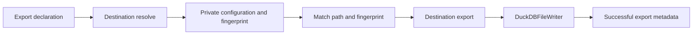

# Exports

Assquack stores asset state in DuckDB tables first. Exports are compatibility
artifacts for lake readers, legacy consumers, recovery workflows, and manual
inspection. They are not the source of truth for an asset.

`FileSystemDestination(base_uri, auth)` implements the general `ExportDestination`
contract. It selects registered local/Azure preparation and compatible
authentication, then calls the separate `DuckDBFileWriter` directly. DuckDB owns
filesystem access and serialization; there is no adapter wrapper, writer registry
or replacement-engine injection. Local and Azure are supplied. Database destinations
remain future work. See [Configuration](configuration.md#exports) for the public
single-destination configuration and [implementation layout](epics/01-mvp/06-extensibility-defects.md#agreed-export-source-layout)
for ownership and extension boundaries.

`resolve()` expands the declaration into formats and exact write paths, selects
preparation and authentication through their registries, retrieves required inputs
once, and retains the resolved configuration privately for the operation.
`export()` uses those selections and calls `DuckDBFileWriter` directly. Preparation
sets up the connection and authentication; it cannot replace the resolved path.

Exports explicitly set DuckDB `USE_TMP_FILE true`: write a temporary file before
replacing the destination after a successful write. DuckDB owns this operation;
Assquack does not add a separate staging/promotion layer. Replacement atomicity
depends on the destination filesystem's rename behavior.



## Manual Exports

`result.export(destination: str | ExportDestination)` requires one destination.
A string is filesystem shorthand with `auth="auto"`, independent of configured
automatic destination. Relative paths and `mad://` aliases resolve under
`<home>/exports`; absolute local paths, file URIs and supported Azure URIs keep
their own location. Local paths need no credentials; Azure uses the existing
automatic authentication selection. No argument-free export is provided.

Strings use the same parser as automatic declarations: a suffix selects Parquet,
CSV or JSON, an extensionless path defaults to Parquet, and a format-only string
uses the asset name. Pipes request ordered formats, for example `orders.csv|json`.

`FileSystemDestination(base_uri="./out", path="orders", format="csv")` supplies
its own manual target and authentication settings. `base_uri` is a directory/root;
`path` is an optional declaration relative to it (absolute paths override it).
Without `path`, the output is `<asset_name>.<format>`, defaulting to Parquet.
Without `format`, the path parser infers the format, defaulting to Parquet.
An explicit `format` must agree with a format alias or suffix and cannot accompany
pipes. Supported format values are `parquet`, `csv` and `json`. For automatic
exports the asset declaration takes precedence over these manual defaults.

Destination implementations accept `resolve(None, asset_name=...)` to select
their own manual target. A concrete automatic declaration is passed unchanged.
The coordinator does not impose file formats on other destination types.
Both entry points share ordered writing and successful-manifest recording.
Manual exports always write; automatic cache retries skip completed outputs.
The return value is one resolved URI string, or an ordered list for multiple
outputs. An explicit export works when automatic exports are disabled.

Results remain live table references. A retained result exports the table's
current publication and records that publication's asset ID, run ID and row
count. If the table has no current Assquack publication, manual export fails.
This resolves the earlier DF-002 [repository finding](reviews/2026-11-04-repository-review.md).

## Why Destinations Need Fingerprints

Assquack keeps asset metadata and materialized tables in DuckDB, independently
of export storage. Changing an export target or its credentials leaves that
DuckDB metadata in place. The same export path can therefore refer to a different
destination on a later invocation; the path alone cannot identify which
destination received the previous export.

The deterministic destination fingerprint identifies the full resolved
destination configuration. Export metadata records that fingerprint alongside
the output path and materialization reference, so a successful export to the
previous destination cannot satisfy an export requested for the new destination.
This requirement applies even with **one configured destination**. It follows
from separating metadata storage from export storage, not from supporting
multiple destinations.

In the MAD.Prefect reference, asset metadata is stored through the same configured
filesystem as the exported result. Switching to a destination without that
metadata produces a cache miss. In Assquack, the existing DuckDB metadata remains
available, so it must explicitly identify the destinations already written to.

Cache behavior keeps materialization validity separate from export
completion: while the DuckDB table remains within its cache period, a missing or
failed export, or a changed destination fingerprint, requires exporting that
table without rematerializing it. Exporting does not restart the materialization
cache period.

One fingerprint describes the resolved destination configuration, including its
base, selected preparation and authentication, and captured authentication inputs.
Individual output filenames, formats, and format options do not enter it. Credential
changes produce a different fingerprint without changing the asset ID. Only the
whole configuration SHA-256 digest is stored, never credentials or reversible
encodings. Deterministic hashes do not protect weak secrets from guessed inputs;
`SecretStr` provides display redaction, not memory encryption or guaranteed erasure.

Each operation uses a private destination copy. Captured authentication is released
on cache hits, successful completion, and failures; temporary DuckDB secrets are
removed after execution. Only one destination is configured per invocation;
there is no cross-destination collision registry.

Credential-chain resolution captures the supported environment inputs directly from the
process environment and fingerprints their values together with the selected chain.
At least one complete client-secret, certificate, or workload-identity input set
is required. DuckDB receives an explicit `env`, `workload_identity`, or
`env;workload_identity` chain; CLI and managed-identity fallback are disabled.
Token acquisition remains DuckDB's job. The fingerprint covers the captured
settings, including configured file paths, not token-file contents or issued tokens.
See [credential-chain inputs](configuration.md#credential-chain-environment-inputs).

## Export Aliases

**Required table-first decorator:** the first
argument identifies the DuckDB table. The optional export declaration is supplied
with `export=`, last after `mode` and `name`. See the
[table-first decision](journal/2026-09-08-mvp-scope.md#table-first-decorator-decision-27-october-2026).

```python
from assquack import asset


@asset(table="bronze.orders", export="bronze/orders.parquet")
def orders():
    return rows
```

`export="bronze/orders.parquet"` retains its logical alias interpretation as
`mad://bronze/orders.parquet`. It specifies a secondary output, not the primary
DuckDB table or database file. Table is required; export remains optional.

## Target Resolution

Export aliases resolve in this order:

1. A URI with an explicit scheme is used as supplied.
2. A relative path is treated as a `mad://...` URI.
3. A file type alias such as `parquet`, `json`, or `csv` derives a path from the
   asset name and configured default export base.
4. Pipe syntax expands one alias into multiple export targets.

`mad://` is Assquack's logical export scheme. It resolves to
the filesystem destination's `base_uri` at runtime, preserving the legacy MAD-style path
shape without making object storage the primary database location.

Example configuration:

```yaml
assquack:
  exports:
    base_uri: abfss://lake/exports/assquack
```

With that configuration:

```text
mad://bronze/orders.parquet
```

resolves to:

```text
abfss://lake/exports/assquack/bronze/orders.parquet
```

If the configured base URI is local, the same alias can resolve to a filesystem
path for development. Asset code should not need to change when moving between
local and ADLS export targets.

## File Type Aliases

The default compatibility target is Parquet. These forms are equivalent when the
asset is named `customer_summary` and the default export base is configured:

```python
@asset("main.customer_summary", export="parquet")
def customer_summary():
    return rows


@asset(table="main.customer_summary", export="parquet")
def customer_summary():
    return rows
```

Both derive a concrete Parquet target from the asset name, for example:

```text
mad://customer_summary.parquet
```

Format aliases:

| Alias | Meaning |
| --- | --- |
| `parquet` | Export the current table as Parquet. This is the default compatibility format. |
| `json` | Export JSON for legacy consumers that still require row-oriented JSON artifacts. |
| `csv` | Export CSV for simple legacy tools and manual exchange. |

A path with a known extension also selects the export format:

```python
@asset("bronze.orders", export="bronze/orders.parquet")
def orders():
    return rows
```

When the path has no extension, Assquack should append the default format unless
an explicit format alias is supplied.

## Pipe Syntax

Pipe syntax lets an asset request multiple compatibility artifacts while keeping
the primary declaration compact.

This is required for MVP by Rowan's 23 October 2026 decision, following the
MAD.Prefect reference. Expansion produces one
target per format before writer/destination selection, all from the same committed
table without repeating extraction.

```python
@asset("bronze.orders", export="bronze/orders.parquet|json")
def orders_with_legacy_json_export():
    return rows
```

This expands to:

```text
mad://bronze/orders.parquet
mad://bronze/orders.json
```

The first target is the default compatibility target. Additional pipe entries
are secondary legacy exports. For example:

```python
@asset("bronze.orders", export="bronze/orders.parquet|json|csv")
def orders_with_legacy_exports():
    return rows
```

expands to Parquet, JSON, and CSV exports using the same base path stem.

Pipe entries may also be used with a type-only alias:

```python
@asset("main.customer_summary", export="parquet|json")
def customer_summary():
    return rows
```

This derives both paths from the asset name:

```text
mad://customer_summary.parquet
mad://customer_summary.json
```

When a filesystem destination is configured, Assquack rejects empty entries,
duplicate formats, unsupported suffixes, multiple base paths, and conflicting
structured `format`/suffix combinations before extraction. With `exports=None`,
automatic export declarations are not resolved or validated. A structured target supplies one format; it cannot also use pipes.
An extensionless path uses Parquet unless its structured `format` selects CSV or
JSON. Manual exports use the same parser; see [Manual Exports](#manual-exports).

## ADLS And ABFSS Exports

Assquack should write ADLS/ABFSS exports through DuckDB whenever possible. The
DuckDB Azure extension supports Azure Blob and ADLSv2 paths, including
`abfss://...`, and lets `COPY` write directly from the published DuckDB table to
the lake target.

The native credential-chain path is equivalent to the following SQL, after
the deployment provisions the Azure extension:

```sql
LOAD azure;

CREATE TEMPORARY SECRET azure_auth (
  TYPE azure,
  PROVIDER credential_chain,
  CHAIN 'workload_identity'
);

COPY (
  SELECT * FROM bronze.orders_current
) TO 'abfss://exampleaccount.dfs.core.windows.net/lake/exports/assquack/bronze/orders.parquet'
  (FORMAT parquet);
```

For MVP, Assquack registers a temporary Azure secret on the export connection.
Native `credential_chain` delegates runtime identity discovery to DuckDB's SDK;
SAS uses the native `config` provider with an environment-supplied token.
Azure `auth="auto"` selects a complete credential chain first, including pod
workload identity. If chain configuration is absent or incomplete, it selects a
complete SAS pair. Explicit `credential_chain` or `sas` overrides that selection
and fails if its required inputs are missing. A failure after selection never
causes a switch to another strategy. Asset authors do not embed credentials in
decorators. See [ADLS credentials](configuration.md#adls-credentials)
for the implemented registration contract and deployment requirements.

The MVP path is DuckDB table to native DuckDB `COPY` to the resolved export URI.
It has no fsspec or Prefect dependency. Credentials come from the process
environment; authentication strategies register native DuckDB secrets. Custom
credential sources, credential blocks and arbitrary connection-string input
remain outside this scope.

## Implemented Azure Export Path

The shared DuckDB file writer supports all three formats with local/file paths and `abfss://`, `az://`, and `azure://`
URIs, including aliases resolved against an Azure destination base. Other remote
schemes remain unsupported. Automatic exports and `result.export(...)`
register temporary credential-chain or SAS authentication on the actual COPY connection;
see [ADLS credentials](configuration.md#adls-credentials) for all configuration.

Exports start only after successful table publication. A failed extraction or
materialization therefore leaves the previous export untouched. Export or
credential-registration failure leaves the committed DuckDB table/run intact and
adds no successful export manifest row. Native remote COPY writes directly to its
target; Assquack does not yet guarantee preservation of the previous remote object
if the COPY itself fails partway through. Remote staging/promotion remains separate
export-phase work. Local writing retains its existing direct-COPY behavior.

Azure routing and failures have offline synthetic coverage; no live Azure access
has been verified. This implementation does not add partitioning, snapshots, or
custom format options. These unsupported destination fields are rejected during
configuration validation.

### Azure Failure Diagnostics

DuckDB and Azure exceptions propagate unchanged from extension loading,
authentication registration, writing and temporary-secret cleanup. Assquack keeps
the original exception object, type, message, traceback, notes and exception
chains. It does not replace native failures with `ExportError`, classify their
text, redact their payloads or suppress their causes. Assquack's own configuration
and target validation still use its existing validation exceptions.

If cleanup also fails after a write failure, the original write failure stays
primary. Cleanup emits a separate warning with its original exception traceback.
If cleanup alone fails, that original exception propagates and no success manifest
is recorded. Temporary credentials are still scoped to the operation, completed
traceback locals are cleared to release captured inputs, and the shared connection
stays open. Cancellation and other process-control exceptions retain their
existing behaviour.

Native exception messages and tracebacks may contain signed URLs, SQL values or
credentials. Consuming applications own access control, retention and any
redaction required by their logging systems. Assquack does not explicitly dump
credential inputs or authentication SQL to logs, but does not mask values that a
native exception contains.

## Format Policy

Parquet is the default compatibility target because it preserves typed columns,
is compact, is efficient for lake scans, and is already the expected bridge for
existing file-backed consumers.

Parquet, JSON and CSV are required MVP export capabilities, confirmed by Rowan
on 23 October 2026. Exporting remains optional per asset; Parquet is the default.
MAD.Prefect output compatibility guides implementation and offline acceptance
fixtures. All three formats are implemented through native DuckDB COPY.

Serialization follows the useful MAD.Prefect artifact shape:

- JSON is UTF-8 newline-delimited JSON: one row object per line, even though the
  filename ends in `.json`. An empty table writes an empty JSON file.
- CSV is UTF-8 comma-separated text with one header, no generated index, normal
  CSV quoting, and empty fields for nulls. An empty table writes the header only.
- Parquet retains DuckDB column types. JSON retains nested object/list values;
  CSV uses DuckDB's text representation for nested values. CSV is intended for
  flat exchange, not lossless nested-type round trips.
- Outputs include the committed table's `_qa_run_id` and `_qa_loaded_at` columns,
  preserving the existing Parquet projection. Values reflect the inferred DuckDB
  schema; formatting and CSV quoting need not be byte-identical to MAD.Prefect.

The additional formats serve existing consumers:

- JSON is useful when existing downstream code expects the old row-oriented
  artifact shape.
- CSV is useful for simple tools, audits, and manual transfer.
- Neither JSON nor CSV should drive Assquack schema inference or cache state.

Dynamic payload columns retain their DuckDB-inferred types, including `JSON`,
and are exported according to DuckDB's format support. JSON text retention
through `_qa_raw_json` remains an explicit audit choice, not the default export
or storage model.

## Export Manifest

Every successful export should be recorded in `assquack_meta.exports`. The manifest
answers "what files were written for this run?" without making those files the
authoritative state of the asset.

The developer-facing storage model describes the manifest purpose in
[Storage Model](storage-model.md#system-tables). The concrete MVP DDL belongs
to the implementor-facing
[Local DuckDB Core epic](epics/01-mvp/01-local-duckdb-core.md#metadata-table-contracts).

`uri` stores the logical target, such as `mad://bronze/orders.parquet`.
`resolved_uri` stores the concrete target used by DuckDB, such as
`abfss://lake/exports/assquack/bronze/orders.parquet`. `role` should distinguish
the default compatibility export from secondary legacy exports.

Each output records its destination fingerprint, actual format, resolved URI, row count and role: `default`
for the first target and `legacy` for subsequent targets. `options_json` records
CSV `header: true` and JSON `array: false`; Parquet uses native defaults.

Formats run in declaration order at the configured destination.
With `exports=None`, no automatic output or export-manifest cache
requirement is added. Manual exports use the destination supplied to `result.export(...)`.

Outputs are written in that order. If one fails, the call raises and
stops exporting. Earlier completed outputs and their manifests remain; the failed
and unattempted outputs receive no success manifest. The committed table and its publication success remain queryable. The run also
records a failed invocation outcome and Export stage, with error details. Within its TTL, a cache-first call reuses that
materialization and writes only outputs lacking a manifest for its run ID,
resolved URI and destination fingerprint. Successful partial outputs are skipped;
retry failures still raise. The original run ID and publication timestamp remain
unchanged, so retries do not restart TTL. Expired or missing tables materialize
again. Uncached calls still materialize and export every requested output.
Assquack does not combine outputs across run IDs or check whether exported files
have since been deleted.

The export manifest is append-oriented per run. A later successful run may write
the same logical target and add a new manifest row. Consumers that need the
latest export should resolve it through the latest successful Assquack run, not
by listing the object storage prefix and guessing.

## Storage Boundary

Exports are not the primary storage source of truth for these reasons:

- DuckDB tables hold the published current asset state and are queried directly
  by `.query()` and `cache_first()`.
- Assquack system tables hold run status, cache metadata,
  and export metadata transactionally with materialization.
- Replaying exported JSON, CSV, or Parquet would reintroduce the file-fragment
  first architecture that Assquack is replacing.
- File exports can be deleted, compacted, overwritten, delayed, or disabled
  without invalidating the current DuckDB table.
- Export schemas are compatibility contracts for consumers, while internal
  tables retain richer metadata columns and DuckDB-inferred types.

The durable recovery target is the DuckDB database and Assquack metadata. Parquet
exports are a compatibility and interoperability surface, not the mechanism that
defines whether an asset exists or whether its cache is valid.

## Related Docs

- [Developer API](developer-api.md): the `@asset(...)` arguments that define
  export aliases.
- [Developer Examples](developer-examples.md): short examples of path and file
  type aliases.
- [Storage Model](storage-model.md): why DuckDB tables remain the source of
  truth.
- [Configuration](configuration.md): default export bases and ADLS credentials.
- [Materialization Lifecycle](materialization-lifecycle.md): when exports are
  written during an asset run.

Manual exports read the current table. If another run has replaced it since the
result was returned, the export manifest uses that current publication's run,
asset identity and count. The retained result's own historical fields do not change.
