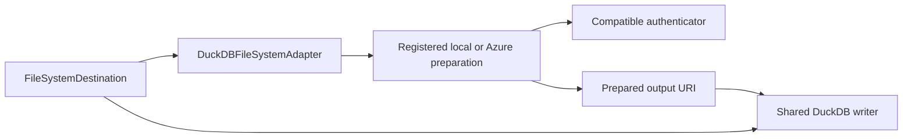

# Assquack MVP scope journal — 8 September 2026

Huddle date: **2026-09-08**, Australia/Sydney
Recorded and reviewed: **2026-10-21**
Azure export authentication decision added: **2026-10-22**
Export formats and migration guiding principle clarified: **2026-10-23**
Export destination configuration shape agreed: **2026-10-23**
Export destination and registry composition recorded for review: **2026-10-23**
Filesystem destination composition and internal extensibility agreed: **2026-10-26**
DuckDB-only writer and filesystem adapter scope agreed: **2026-10-27**
Status: **Scope finalized by Rowan for implementation**
Participants: Maitland Marshall and Rowan Farquharson

## Table-first decorator decision (27 October 2026)

**Decision owner: Rowan Farquharson. Status: agreed; implementation pending.**
The path-first decorator convention is superseded. The argument order is
`table`, `mode`, `name`, then `export`. The table can be supplied positionally
(`@asset("sales.orders")`) or explicitly by keyword (`@asset(table="sales.orders")`).
Keyword usage is preferred for clarity but is not mandatory for the table.
`mode`, `name` and `export` remain keyword-only. Export is optional and appears
last, after `name`; a positional string must no longer mean an export path.

```python
@asset(
    table="sales.orders",
    mode="replace",
    name="sales_orders",
    export="sales/orders.parquet",
)
def orders():
    ...
```

This ordering reflects DuckDB tables as the primary materialized output and
exports as optional secondary outputs. Existing table/name inference and default
`mode="replace"` are unchanged by this ordering decision. Do not preserve the
old positional-export interpretation with a compatibility shim. Historical
path-first documentation remains history, not the active contract.

This records the decision only; it does not change the Python decorator yet.
See [Developer API](../developer-api.md#asset) for the target signature and
[Developer Examples](../developer-examples.md) for usage.

## Destination fingerprint rationale (27 October 2026)

**Decision owner: Rowan Farquharson. Status: agreed.** Destination fingerprints
are required because Assquack stores asset metadata in DuckDB independently of
export storage. Changing an export target or its resolved authentication inputs
does not move or remove the existing asset metadata. A path alone cannot tell
that metadata whether the requested destination is the one previously written to.

Identify the destination with a deterministic fingerprint of its full resolved
configuration, including preparation, authentication, and resolved provider or
environment inputs. Persist the fingerprint, not the secret input values, with
the export path and materialization reference. Changed credentials intentionally
change export identity without changing asset identity.

This decision is **not intrinsically linked to multiple export destinations**:
one configured destination can change between invocations and needs the same
identity tracking. The distinction from the MAD.Prefect reference is that its
metadata lives on the configured export filesystem; a new destination without
that metadata already causes a cache miss.

While the materialized DuckDB table is still within its cache period, retry a
failed export or export to a changed destination using that table. Do not
rematerialize it or restart its cache period just because an export is needed.
The separation of materialization validity from export completion is agreed
behavior, with implementation still pending. See the
[export rationale](../exports.md#why-destinations-need-fingerprints).

## Purpose and evidence

Record the Assquack suggestions discussed in the huddle, Rowan's responses,
and the finalized first-release scope for implementation. This is a retrospective
journal: decisions made on 21 October are not backdated to the huddle.

Sources: [Slack huddle and follow-up thread](https://maitdev.slack.com/archives/C0BS93HN9FH/p1788843649508289),
[huddle notes](https://maitdev.slack.com/docs/T0ALUHBDASW/F0C09JLQWFK), and the
[huddle transcript](https://maitdev.slack.com/files/USLACKBOT/F0C05NYFWJJ/huddle_transcript).
The transcript was downloaded and read during this review. Slack's transcript
link may not open directly. Timestamps below are approximate elapsed huddle
times. Automatic transcription contains errors; descriptions below paraphrase
the discussion rather than treating every transcribed technical term as exact.

Repository observations describe the working tree on 21 October 2026:
`feat/prototype` at `9ebbdb9`, including uncommitted changes. Existing code is
evidence of implementation progress, not approval of a proposed requirement.

## Finalized release boundary — 21 October 2026

**Decision owner: Rowan Farquharson.** Narrowing the first stable release to a
useful, extendable replacement for MAD.Prefect data assets is Rowan's proposal.
It deliberately reduces Maitland's earlier MVP scope so simple existing
replace-only projects can migrate sooner. Maitland's huddle suggestions are
attributed below; this journal does not claim he approved the October reduction.

The compatibility baseline is the useful data-asset workflow: argument binding,
path templates, cache-first execution, SQL queries, sync/async batches, and inputs
including HTTP responses, pandas, Arrow and DuckDB relations. Preserve that
behaviour in a standalone library without importing Prefect. Validate partitioned
project behaviour before migration; partitioning is not permission to add delta
or merge semantics. This is behavioural compatibility, not a promise to reproduce
every implementation detail or bug of MAD.Prefect.

**Decision, 23 October (Rowan):** Replacing MAD.Prefect data assets is a guiding
principle when deciding MVP scope. Use its useful existing workflows and output
compatibility to assess what migrating projects need. This is a behavioral guide,
not a core dependency or a requirement to reproduce every feature. Explicit
exclusions below remain in force; new scope questions still require a decision.

Keep the existing decorator and string-based materialization mode. Use the agreed
`schema.replace` configuration boundary and implement an actual current-run schema
strategy now. Keep it extensible for continuation later, without empty strategies,
nonfunctional switches, or a replacement public API. Configuration must support
asset-specific application through the existing per-call config override.

This journal owns the October scope where older architecture or phase documents
still describe historical schema continuity or observations. Those documents and
code must be aligned during implementation; finalized scope does not mean the
implementation is complete.

## Confirmed exclusions

Rowan explicitly excludes merge-related work from the MVP. The MVP remains
full-extraction, replace-only materialization.

Out of scope for MVP:

- Merge, upsert and incremental append modes, including a minimal merge mode.
- Primary-key contracts and conflict resolution for incremental publication.
- Delta assets, delta parameters, watermarks and partial-source updates.
- A merge-specific overflow column, schema quarantine, review or promotion
  workflow for unresolved fields.
- Snapshot history and time travel as publication modes.

This does not exclude `VARIANT` for heterogeneous values within a single full
extraction. Nor does retaining run diagnostics imply support for delta ingestion.
The existing strategy boundary may remain without implementing more modes.

The decisions below are settled for this first release. Do not reopen them merely
because older documents or the existing implementation differ.

## Huddle discussion and finalized decisions

### 1. Native JSON ingestion and deep inference

**Huddle, 27:47–29:15 and 36:07–37:44.** Maitland proposed using DuckDB's native
filesystem reader over local JSON fragments instead of raw `VARIANT` staging.
Preserving deep inference from actual source payloads was his stated invariant.
Rowan checked his interpretation of the benchmark results, explained the existing
raw/staged/current-table design, and discussed simplifying the staging path.

**Repository:** The uncommitted rewrite writes NDJSON fragments, infers over all
completed files, and builds a typed candidate table. Separate schema-observation
queries still run. A whole-row `_qa_payload` is no longer mandatory.

**Decision, 21 October:** Use separate, size-controlled NDJSON fragments for the
replace-only ingestion approach. Rowan accepted this after discussing payload
preservation, progressive writing and recovery boundaries. A yielded mapping can
contain a complete response envelope; the framework must not implicitly extract
its `data` field. NDJSON does not require uniform fields across records or preserve
the original HTTP response bytes. Historical schema behaviour remains item 5.

### 2. Fragment placement and canonical asset state

**Huddle, 28:11–28:57 and 34:44–35:56.** Maitland said fragments should live beside
the DuckDB database and exports should be artifacts of its tables. Rowan
explicitly checked that fragment placement need not relate to export locations;
Maitland agreed. Managed disk was deployment context, not a proposed core-library
dependency.

**Repository:** Uncommitted configuration defaults fragments to a directory beside
the database. Export destinations remain separate; DuckDB tables and metadata
continue to determine asset state.

**Decision, 21 October:** Keep fragments beside the DuckDB database, independently
of export destinations. Rowan confirmed that fragments feed database ingestion
and belong to its working storage, although they are external files rather than
contents of the database file. Exports are downstream outputs. This placement
decision does not add a deployment platform or infrastructure rollout to MVP.

### 3. Framework-controlled fragment sizing

**Huddle, 30:55–33:32.** Rowan raised the cost of many tiny fragments. Maitland
suggested that a yield could flush buffered entities without defining a fragment
boundary, leaving fragment size to the framework. Rowan proposed a configuration
setting; Maitland suggested megabytes.

**Repository:** The new writer uses `ingestion.fragment_max_rows`, independently
of normalization chunk size. This bounds rows per file, not bytes per file.

**Decision, 21 October:** Use separate fragments rather than one unlimited file.
Completed fragments provide recovery boundaries, but do not themselves implement
resume. Atomic replacement of the published table remains a separate guarantee.

**Decision, 21 October:** Use a configurable byte-size threshold, expressed in
megabytes, rather than row count. Finish writing each complete NDJSON record,
then roll over to a new fragment when the threshold is reached or exceeded.
Never split a record between fragments. The threshold is a target, not a hard
cap: the final record can take a fragment over it, and a single oversized record
must remain intact. The default threshold and exact MB/MiB convention remain
implementation details to resolve explicitly. Compression is not added by this
decision. The current row-count implementation still needs to be updated.

**Later clarification, 9 September:** Maitland corrected his claim that managed
disk removes small-file concerns and agreed that controlled sizing still matters.
See his [correction](https://maitdev.slack.com/archives/C0BS93HN9FH/p1788926313884899?thread_ts=1788843649.508289).

### 4. Interrupted runs, replay and retention

**Huddle, 33:37–34:14.** Rowan asked what happens when writing is interrupted.
Maitland discussed being able to resume; both treated NDJSON behaviour as something
to investigate. Their speculation about a schema header and inherent compression
is not an accepted format requirement.

**Repository:** The new writer uses `.partial` files, completed fragment renames
and a `_COMPLETE` capture marker. It does not implement resuming extraction from
an API cursor. Fragment retention and recovery cleanup remain unfinished.

**Decision, 21 October:** Retry failed runs by starting a fresh extraction from
the beginning, with a new run and new fragments. Resuming half-finished runs,
reusing their fragments to complete an extraction, and persisting API cursors
for resume are outside MVP. Rowan noted that source data may change between
attempts, particularly across days; combining old and new responses could mix
different source states. Fresh extraction avoids carrying earlier attempts into
the replacement, but does not itself guarantee a source-wide snapshot during
pagination.

**Retention, confirmed 21 October:** Retain the latest successful run and the
latest three failed runs per asset. This carries forward the original MVP
retention requirement; Rowan did not propose changing it. Implement cleanup
without deleting the successful run's fragments because a later attempt failed.
Retention is for inspection and diagnosis, not resuming extraction.

**Decision, 21 October:** A failed new run must leave the last successfully
published table intact. Build the replacement separately and publish it atomically
only after successful materialization. If the first run fails, no asset table is
published. Rowan compared this with the existing data assets' successful-export
replacement behaviour, while explicitly applying the decision to the DuckDB
table here. Publication safety and fresh extraction on retry are both confirmed;
completed fragments from a failed attempt must not be used by the retry.

The [Productive MVP task](https://app.productive.io/44734-mait-dev/tasks/task/20199706)
already calls for safe reruns and demonstrated restart or recovery. Deferring
cursor-level resume would not remove that existing recovery acceptance criterion.

### 5. Schema behaviour between full replacements

**Huddle, 37:50–43:16.** Maitland initially suggested failing on substantial schema
differences and holding new fields in an extra `VARIANT` column for review. Rowan
questioned why a new field would not simply appear in the next replacement table,
then clarified that he understood MVP to be replace-only. The discussion shifted
to recreating schema observations for replace. Maitland agreed, while allowing
Rowan to retain evidence if there was a useful reason.

**Repository:** Both committed code and the uncommitted rewrite combine the new
schema with the previous successful schema. Missing historical columns remain,
types widen, and historical structure influences the next run. This is retained
earlier behaviour, not newly introduced merge support. New fields are not held
in a review queue.

**Decision, 21 October (Rowan):** Infer the replacement table from the current
run's completed fragments only. Do not impose a prior run's columns or types on
it. A removed source column can disappear from the published table, and downstream
queries expecting it may fail. Historical schema compatibility is not implicit.

Remove historical reconciliation and detailed field/type observations from the
MVP execution path. Recording the resulting table schema and ordinary run status
is distinct from maintaining detailed observation history. Existing working
observation code does not make it a release requirement.

Implement the current-run strategy behind `schema.replace` now. After the first
release is working, implement optional schema continuation on a separate branch,
allowing consumers to choose it for individual assets. Observation support may be
added later through an extension point. Do not expose an unsupported continuation
option or implement an empty strategy in MVP. Append/merge schema rules belong to
those future modes, not to this release.

### 6. Native export path and aliases

The [27 October decision](#duckdb-only-export-boundaries-27-october-2026)
owns the current destination design. Earlier configuration and pseudocode in
this section remain discussion history where they differ from that decision.

#### Agreed export configuration shape — 23 October

**Decision owner: Rowan Farquharson. Status: agreed design, not implemented.**

`AssquackConfig.exports` is a list of `ExportDestination` objects. Do not wrap
the list in an additional `ExportConfig` object with a `destinations` field.
An empty list means no configured automatic exports, replacing the need for a
separate global `enabled` flag in this proposed configuration.

Every `ExportDestination` has the same three configuration parameters:

| Parameter | Meaning |
| --- | --- |
| `base_uri` | Base export location, independent of the asset's relative path. |
| `writer` | The export-writing implementation selected for this destination. |
| `auth` | The authentication method selected for this destination and writer. |

Each destination selects its own writer and authentication method. A single run
can export to multiple configured locations using different writers. Two entries
may use the same storage backend with different locations or authentication.
Asset declarations remain independent of deployment storage choices.

The agreed developer-facing shape is:

```python
config = AssquackConfig(
    exports=[
        ExportDestination(
            base_uri="abfss://account.dfs.core.windows.net/container",
            writer="duckdb",
            auth="sas",
        ),
        ExportDestination(
            base_uri="s3://archive-bucket/exports",
            writer="fsspec",
            auth="default",
        ),
    ],
)
```

This is proposed API syntax, not executable current API. The second entry
illustrates independent writer selection; it does not add an fsspec writer or
S3 implementation to the approved MVP delivery scope. Each integration defines
its supported authentication names. Credentials are not additional parameters
on these objects; the current design direction uses environment-provided
credentials or the selected mechanism's identity discovery.

This decision supersedes the earlier single-base-URI configuration shape and
the proposed backend-specific settings beside one shared base URI. It does not
choose inheritance between destination and writer: they are separate concerns
combined through composition. The method and registry direction is recorded
below. Authentication defaults, environment-variable mapping for a destination
list, and migration from the existing `ExportsConfig` remain to be designed.
Recording this agreement does not authorize implementation agents or code changes.

#### Export destination and registry composition — 23 October

**Decision owner: Rowan Farquharson. Status: accepted design direction for
independent review; not implemented.**

Rowan accepted the `ExportDestination` and `ExportRegistry` composition below
and requested it be recorded for a separate agent to review. The destination
obtains its writer, obtains a compatible authenticator, then delegates export
execution to the writer with that authenticator. This leaves the writing
mechanism replaceable without changing asset declarations.

Responsibilities:

- `ExportDestination` holds `base_uri`, `writer` and `auth` and coordinates their
  selection through `get_writer()`, `get_authenticator()` and `export()`.
- `ExportRegistry` maps writer names to factories and authentication combinations
  to factories. Factories create implementations, rather than storing shared
  credential-bearing instances in the registry.
- The selected writer interprets the base URI to identify its supported backend.
  Authentication lookup uses `(writer, backend, auth)` so a method is selected
  for the actual writing mechanism and storage backend.
- The writer owns execution and invokes the authenticator at the appropriate
  point. A DuckDB writer configures its export connection before `COPY`; another
  writer may use a different authentication mechanism.
- `format` is an argument to `writer.write()`. Each writer handles format-specific
  serialization or options internally. Separate methods per format are permitted,
  but not required: DuckDB can share a `COPY` path with format-specific options.
  The shared destination coordinator does not implement Parquet, CSV or JSON.
- `source` denotes the already-materialized data. Its precise interface must be
  reviewed so alternative writers can consume it without repeating extraction.

The following is the complete discussed pseudocode for the destination and
registry. It illustrates the accepted separation, not production validation,
typing or lifecycle guarantees. Concrete writer/authenticator implementations
remain separate from these two objects.

```python
class ExportDestination:
    def __init__(self, base_uri, writer, auth):
        self.base_uri = base_uri
        self.writer = writer
        self.auth = auth

    def get_writer(self, registry):
        return registry.create_writer(self.writer)

    def get_authenticator(self, registry, writer):
        backend = writer.identify_backend(self.base_uri)
        return registry.create_authenticator(
            writer=self.writer,
            backend=backend,
            auth=self.auth,
        )

    def export(self, source, relative_path, format, registry):
        writer = self.get_writer(registry)
        authenticator = self.get_authenticator(registry, writer)
        return writer.write(
            source=source,
            base_uri=self.base_uri,
            relative_path=relative_path,
            format=format,
            authenticator=authenticator,
        )


class ExportRegistry:
    def __init__(self):
        self.writers = {}
        self.authenticators = {}

    def register_writer(self, name, factory):
        self.writers[name] = factory

    def register_authenticator(self, writer, backend, auth, factory):
        self.authenticators[(writer, backend, auth)] = factory

    def create_writer(self, name):
        if name not in self.writers:
            raise ValueError(f"Unknown writer: {name}")
        return self.writers[name]()

    def create_authenticator(self, writer, backend, auth):
        key = (writer, backend, auth)
        if key not in self.authenticators:
            raise ValueError(f"Unsupported authentication combination: {key}")
        return self.authenticators[key]()
```

Review must resolve the typed writer/authenticator/source contracts; registry
ownership and duplicate-registration policy; unsupported format/backend errors;
`auto` and local/no-auth behavior; credential validation and safe diagnostics;
resource cleanup; and successful-output/manifest behavior across destinations.
The simple dictionary assignment above does not settle whether overriding a
registered name should be permitted. Existing single-destination authentication
defaults must not be silently treated as approved rules for every future writer.

This records a design for review only. It does not authorize implementation,
new integrations, or launching a reviewer. Related work is tracked in the
[extensibility defects register](../epics/01-mvp/06-extensibility-defects.md).

#### Evening design snapshot — 23 October 2026

**Status: direction recorded for continued design; not an implementation
instruction or finalized public contract.** This snapshot qualifies the earlier
writer-selection pseudocode above. Do not implement that earlier shape without
accounting for this discussion.

DuckDB `COPY` remains the export-writing operation. The asset's export path or
type declaration selects Parquet, CSV or JSON, including pipe-separated formats.
Format-specific writing may have internal helpers, but developers do not select
a format writer in destination configuration.

The emerging configuration shape is `ExportDestination(base_uri, transport,
auth)`, replacing the earlier `writer` setting with `transport`:

- `base_uri` identifies the output location. Its scheme selects the destination
  kind; plain paths select local storage.
- `transport="duckdb"` selects native DuckDB access. Within that integration,
  registered implementations handle local, Azure or future destination-specific
  setup. The shared writing operation must not accumulate hardcoded backend
  branches.
- `auth` selects compatible authentication. Authentication is distinct from
  extension loading and filesystem setup, even when one integration coordinates
  both.

MVP implements only DuckDB transport, local and Azure destinations, no
authentication for local, and SAS or native credential-chain authentication for
Azure. Local uses DuckDB's built-in filesystem; Azure uses its Azure extension.
A future native S3 integration would use HTTPFS and compatible authentication.
This is not all authentication behavior, nor does native access necessarily
register a Python filesystem.

fsspec is a future extensibility example, not an MVP implementation, dependency
or fallback. A registered fsspec filesystem can provide file access underneath
DuckDB `COPY`; it need not replace DuckDB's format writer. Quackframe's SFTP
integration demonstrates that distinction. Native DuckDB remains the preferred
execution path, with DuckDB tables and metadata retaining canonical asset state.

`AssquackConfig.exports` should accept either one `ExportDestination` or a list
of them, normalizing a single object to a list internally. An empty list means
no configured automatic exports. This updates the list-only shape above.

Open questions for the next discussion:

- Confirm `transport` as the public name and the exact relationship between
  destination behavior and transport-specific implementations.
- Decide how compatible authentication is selected and owned. A future fsspec
  integration may configure adlfs/its Azure SDK directly; do not require a
  separate authenticator class solely to mirror DuckDB secret registration.
- Define the preparation, writing, publication and cleanup contracts, including
  which resources each implementation owns. Preserve a shared COPY operation
  without forcing unrelated integrations into the same resource interface.
- Review the pending fsspec research before finalizing registry keys, typed
  interfaces or the proposed directory structure. Earlier writer-based examples
  and the proposed folder layout remain design history, not settled contracts.

The [export destination research](../research/2026-10-23-export-destination-architecture.md)
supports sharing COPY while separating destination-specific operations. The
visible chat **Research fsspec export extensibility** is assessing the additional
filesystem/authentication boundary; its findings have not yet been adopted here.

#### DuckDB-only export boundaries (27 October 2026)

**Decision owner: Rowan Farquharson. Status: agreed design; implementation
pending.** This supersedes the replaceable writer and filesystem-adapter design
below. The earlier design and supporting research are preserved in commit
`8bacb3d` (`docs: preserve export extensibility design and supporting research`).
That commit records considered architecture, not an implemented alternative.

We gave extensible filesystem adapters and writers detailed consideration,
including alternatives such as fsspec and PyArrow. We decided not to implement
those extension points: they overcomplicate the product and move away from the
core goal of a DuckDB-native data engineering framework. DuckDB is the filesystem
adapter and the writer, with filesystem access and authentication capabilities
bounded by its core and community extensions. This does not add support for every
DuckDB extension in MVP; local and Azure destinations remain the supplied scope.

**Composition and layout refinement, agreed later on 27 October:** absorb the
adapter wrapper's coordination into `FileSystemDestination`. DuckDB still fills
the architectural role of filesystem adapter, but no `DuckDBFileSystemAdapter`
class or `filesystem_adapter/` directory is required. This explicitly replaces
the earlier proposal to retain that wrapper and directory.

`FileSystemDestination` selects preparation by URI scheme through a preparation
registry and selects compatible authentication through an authentication
registry. It composes the separate `LocalPreparationStrategy` or
`AzurePreparationStrategy` with that authenticator, enters preparation, and calls
`DuckDBFileWriter` directly. Registry selection must not be replaced with
if/elif dispatch. Authentication owns temporary-secret setup and cleanup.

Keep the destination in `destinations/filesystem.py`, preparation classes in
`preparation/`, authenticators and internal credential providers in
`authentication/`, and `DuckDBFileWriter` in `writer/file.py`. The writer remains
a separate responsibility; the destination does not absorb COPY implementation.
A separate writer folder does not imply a registry. There are no writer/adapter
replacement registries or injection points. Formats come from asset declarations;
one file writer handles Parquet, CSV and JSON through DuckDB COPY options.

A future `destinations/database.py` may invoke its own DuckDB table writer in
`writer/table.py` directly. The common extension boundary is `ExportDestination`,
not a universal writer that branches on destination type. Neither database file
nor table writer is part of this implementation. Database target-path syntax and
write semantics remain future design work. See the
[agreed source layout](../epics/01-mvp/06-extensibility-defects.md#agreed-export-source-layout).

The extension points deliberately retained are:

- **Destination types:** `ExportDestination` remains the general contract, with
  `FileSystemDestination(base_uri, auth)` supplied now. A future
  `DatabaseDestination` can use connection/table settings without being forced
  through filesystem paths or file formats. `AssquackConfig.exports` accepts one
  destination or a list; an empty list disables configured automatic exports.
- **Authentication methods:** retain extensible authenticators and their lifecycle
  for preparation, temporary-secret setup and cleanup. Native DuckDB identity
  discovery remains native; this is not permission to substitute filesystem engines.
- **Credential providers:** retain internal direct provider-instance injection,
  defaulting to environment sourcing. The reason is future multi-destination
  exports: different destinations may require different credentials or credential
  sources. Providers supply values to authenticators; they do not themselves
  implement destination routing or resolve per-destination credential selection.
  That selection remains an implementation decision. Public provider injection
  stays deferred, with the door open to expose it later; no provider registry or
  new credential-source integration is required now.

The earlier provider lifecycle discussion remains design context, not a claim of
implemented asynchronous loading. This amendment changes documentation and
acceptance scope only; it does not claim the destination refactor is complete.

**Implemented and reviewed, 27 October:** the working tree follows this layout
and configuration. All 198 offline synthetic tests pass; focused type checks and
independent visible-chat re-review found no unresolved in-scope issues. See the [extensibility register](../epics/01-mvp/06-extensibility-defects.md)
for final evidence and limitations; the historical alternatives below remain a
record of superseded design rather than the current implementation contract.

#### Agreed filesystem destination pattern (26 October 2026)

**Historical design:** the [27 October decision](#duckdb-only-export-boundaries-27-october-2026)
supersedes writer/adapter substitution and the separate adapter wrapper in this
section. Preparation and authenticator registries remain required; only the
writer/adapter replacement registry requirements are superseded. Retained
boundaries and the current ownership of preparation are clarified there.

**Decision owner: Rowan Farquharson. Status: agreed design; implementation
pending.** This supersedes the earlier public `writer` and proposed `transport`
settings and settles the composition pattern discussed above. Recording the
decision does not claim that the current implementation exposes this API.

`ExportDestination` is the general export contract. `FileSystemDestination` is
the concrete destination supplied now, exposing `base_uri` and `auth` only.
A future `DatabaseDestination` can implement the broader contract with its own
connection/table settings; it must not be forced through filesystem paths or
file-format assumptions. Database output is not implemented by this decision.

The proposed downstream Python API is:

```python
config = AssquackConfig(
    exports=[
        FileSystemDestination(base_uri="./exports"),
        FileSystemDestination(
            base_uri="abfss://account.dfs.core.windows.net/container/exports",
            auth="sas",
        ),
    ],
)
```

`exports` also accepts one destination object directly and normalizes it to a
list internally. An empty list means no configured automatic exports. The
default authentication choice is `auto`: no authentication locally; Azure uses
the established complete-SAS-pair/absent-pair/partial-pair selection rules.
Explicit Azure SAS and credential-chain choices remain supported.

**Writer and filesystem adapter are separate, replaceable internal components.**
DuckDB is the only supplied implementation and the fixed default for both in
MVP. Neither is configurable through `FileSystemDestination` or another public
MVP setting. Public configuration for alternative implementations may be added
later when required. Retain internal registration/construction boundaries so
replacement does not require rewriting export coordination; an unused interface
alone does not establish extensibility. No fsspec implementation, dependency or
automatic fallback is introduced. Use the term **filesystem adapter**, not
transport. If organized into packages, use singular `writer/` and
`filesystem_adapter/` names.

**Credential-provider decision, 26 October (Rowan):** leave a non-public entry
point for direct injection of a credential-provider instance. Do not add a
credential-provider registry, named provider selection, or a public
`credential_provider` argument to `FileSystemDestination` in MVP. Existing
environment-based credential sourcing remains the default when no provider is
supplied internally. This is an extensibility boundary, not authorization to
implement Prefect blocks, vault integrations or other new credential sources.

The intended future provider contract separates loading from lookup:
`await provider.load()` makes values available, and `provider.get(name)` returns
one requested value. Each provider owns how it loads its values; no separate
fetch callback is required. Providers are generic value sources, not Azure- or
SAS-specific authentication strategies. Do not pass the complete mutable process
environment around, or log/serialize credentials. How asynchronous loading joins
the synchronous execution path remains an implementation detail to settle before
shipping that integration, not a promise of completed async support.

When public injection is introduced later, downstream users can supply their own
provider implementing the contract without registering it or adding its code to
Assquack. Registries still select supported authentication and destination
preparation strategies; credential sourcing uses direct injection. Native DuckDB
identity discovery remains native and is not replaced by a custom provider.
This decision does not itself resolve per-destination credential selection or
change the number of export locations supported.

The agreed class responsibilities and call sequence are:

1. `FileSystemDestination.export()` obtains the DuckDB adapter and writer from
   `ExportRegistry`, enters adapter preparation, then calls the writer with the
   committed source, prepared output URI and selected format.
2. `DuckDBFileSystemAdapter.get_preparation_strategy()` asks the registry for
   the preparation strategy matching the adapter and URI scheme. There is one
   DuckDB adapter, not a separate filesystem adapter for local and Azure.
3. The adapter obtains compatible authentication using the adapter name,
   destination kind and authentication choice. It delegates `prepare()` to the
   selected strategy, passing that authenticator by composition.
4. `LocalPreparationStrategy` resolves the path and ensures the parent directory
   exists. `AzurePreparationStrategy` resolves the URI and loads the installed
   Azure extension. Each enters the authenticator's context and yields the URI.
   Preparation classes stay small; their existence does not justify duplicate
   upload clients or additional storage operations.
5. The authenticator owns temporary-secret registration and cleanup. Local
   authentication is a no-op; Azure reuses the existing SAS and native
   credential-chain behavior. Native identity discovery stays with DuckDB.
6. `DuckDBWriter.write()` executes shared `COPY`, selecting validated options
   for Parquet, CSV or JSON. It contains no local/Azure preparation branches.
   Formats come from the asset path/type declaration, including pipe expansion,
   not from destination configuration. Both automatic and explicit exports
   must use the same composition boundary.

`ExportRegistry` owns factories for adapters, writers, preparation strategies
and authenticators. Preparation lookup uses `(adapter, URI scheme)`; ordinary
Windows/POSIX paths select local preparation. Authentication lookup uses
`(adapter, destination kind, auth)`. Registry state belongs to an instance, not
global mutable setup. Keep named construction methods and straightforward class
factories. Unknown combinations must fail clearly; duplicate-registration and
resource-lifetime details still need implementation-level resolution.



The [version-matched source research](../research/2026-10-26-duckdb-filesystem-preparation.md)
establishes that DuckDB owns native filesystem selection, file opening,
serialization, buffering, writing/uploading and closing. Loading the Azure
extension registers its native filesystems; Assquack does not register Python
filesystems for this path. Flat Blob prefixes need no directory creation, but
containers must exist. Automatic missing-parent creation for ADLS remains
unverified and must not be promised or replaced with speculative SDK calls.

**Publication safety remains separate unfinished work.** The accepted simplified
pseudocode describes preparation and direct COPY, not guaranteed preservation of
an existing Azure output after a failed write. Do not silently drop that release
requirement, or reintroduce staging/promotion into basic preparation as though
DuckDB requires it. Define and verify publication separately, including accurate
manifests and failure cleanup. The earlier large staging examples are not the
agreed preparation implementation.

#### Export format and pipe decisions

**Decision, 23 October (Rowan):** Parquet, CSV and JSON are the required starting
export file types for MVP, using MAD.Prefect as the compatibility guide. Parquet
remains the default. CSV and JSON are required capabilities, although exporting
is optional for an individual asset. Implement format selection through an
extensible writer boundary; do not couple each format to a particular destination.
Verify representative output compatibility against the MAD.Prefect reference
using offline fixtures. Exact JSON layout and format options must be established
from that review rather than assumed. It does not approve every historical export
option.

**Further decision, 23 October (Rowan):** Pipe-separated export formats are an
MVP requirement, following MAD.Prefect's multiple-artifact behavior. A declaration
such as `bronze/orders.parquet|csv|json` must expand into three export targets with
the same path stem and their respective extensions. Resolve the targets before
selecting format writers and destinations; export the same committed table to
each target without repeating extraction. Preserve the documented type-only
form, such as `parquet|json`, deriving the stem from the asset name. The first
target is the default compatibility target. Test target expansion, each output
and its manifest, and failure behavior when one of several exports fails; do not
assume atomic publication across all files. The current parser rejects pipes, so
this is required implementation work, not a claim of existing support.

**Huddle, 46:21–50:38.** Rowan checked how local development and deployed export
locations would work. Maitland preferred dropping the fsspec adapter from the
normal path, keeping a manually resolved `mad://` alias, and using DuckDB's Azure
extension for exports. Rowan agreed that exports no longer need the fragment
filesystem adapter. Configuration and support for multiple destinations remained
questions.

**Repository:** Alias resolution and native local Parquet export already exist.
The writer still rejects remote destinations; Azure export is a TODO. The
uncommitted rewrite has not implemented new cloud export support.

**Decision, 21 October (Rowan):** Both local filesystem and Azure exports are
required for MVP. Keep export destinations independent of the local fragment and
DuckDB storage paths. Preserve aliases and the existing export configuration
surface, with a destination abstraction that can support more backends later.
Other backends are not a first-release requirement. Preserve the successful-output
behaviour: a failed extraction/materialization must not replace the last successful
export with partial output. Azure implementation and verification remain work to do.

**Decision, 22 October (Rowan):** Azure exports use native DuckDB authentication.
Assquack registers a temporary Azure secret with `PROVIDER credential_chain` on
the connection performing the export. DuckDB's Azure SDK discovers the runtime's
credentials; Assquack does not recreate that detection logic. Allow optional
explicit chain selection, such as `workload_identity`, for deployments requiring
a particular method. The account is identified by a fully qualified export URI
or `ACCOUNT_NAME` in the secret.

Keep registration extensible for connection-string/SAS support later; those
methods are not part of the MVP authentication path. No fsspec fallback or
Prefect credential-block integration is required for this path. MAIT DEV is one
downstream user, so core authentication must not assume its deployment platform,
legacy environment variables or credential-management system. This is Rowan's
October decision, not an attribution to the September huddle. See
[ADLS credentials](../configuration.md#adls-credentials) for the contract.

**Later amendment, 22 October (Rowan):** Implement SAS authentication now,
superseding the earlier same-day deferral of SAS. Keep authentication strategies
(how DuckDB authenticates) separate from credential providers (where explicit
credentials come from). Retain native `credential_chain`; add native `config`
secret registration with a SAS connection string. The MVP provider reads
`AZURE_STORAGE_SAS_TOKEN` and `AZURE_STORAGE_ACCOUNT_NAME` at Azure export time.
Automatic selection uses SAS for a complete pair, credential discovery for no
pair, and a clear error for a partial pair. Explicit `credential_chain` ignores
SAS variables; explicit `sas` requires complete credentials. Empty/whitespace
values count as absent. A contradictory explicit chain selection must fail rather
than being silently ignored. See [configuration](../configuration.md#adls-credentials)
for the precise footprint and precedence.

Use Quackframe as a reference for strategy/provider separation, without adding a
dependency or a block implementation. No `.env` loading or custom native-identity
variable scanning. Keep tokens out of public config, errors and durable metadata;
use bound SQL, validated connection-string fields and temporary scoped secrets.
Verify with offline synthetic tests and paired review. Real storage verification
and preservation of a remote target during partial COPY failure remain separate
work; this amendment does not mark the complete export MVP finished.

### 7. Future extension points

**Huddle, 44:25–45:21 and 48:39–51:35.** Rowan described a strategy boundary for
future materialization modes and keeping optional configuration integration
outside MVP. Maitland discussed possible DuckLake adapters, native filesystem
aliasing and a future client/server architecture.

**Repository:** A commit-strategy interface and replace implementation already
exist. The public API rejects modes other than `replace`.

**Decision, 21 October:** Preserve practical extension points for schema strategy,
observations, materialization mode and export destinations. Implement the replace
and current-run strategies now. Continue schema work on a later branch; implement
append/merge on further branches if Maitland wants them. DuckLake, client/server
operation and optional configuration integrations are future work, not MVP gates.

### 8. The minimal-merge suggestion

**Huddle, 39:51–42:34 and 45:33–45:58.** Rowan said he understood the MVP to be
replace-only. Maitland initially agreed to get replace working first, then
suggested that MVP could go straight to a simple merge using primary keys and
an unresolved-data `VARIANT` column. Rowan acknowledged the suggestion in the
conversation; that acknowledgement is not recorded here as a settled requirement.

**Decision, 21 October:** Out of scope for MVP, including the suggested minimal
version. Do not implement delta semantics as part of the fragment rewrite.

## Implementation sequence and acceptance

The September fragment rewrite is preserved in commit `89ae20f`
(`feat(ingestion): replace VARIANT staging with NDJSON fragments`). It is the
starting point, not the implementation of all October decisions.

1. Implement current-run-only schema inference behind the agreed strategy boundary;
   remove historical reconciliation and detailed observations from the active flow.
2. Replace row-count fragment sizing with a configured megabyte target that never
   splits records. Document the default and units as implementation choices.
3. Complete fresh-run failure handling and fragment retention. Test first-run
   failure, failed refresh with a published table, and a clean subsequent retry.
4. Complete Parquet, CSV and JSON exports to local and Azure destinations,
   including successful-output preservation.
5. Verify the MAD.Prefect compatibility baseline with representative offline
   fixtures, update owning architecture/phase docs, and resolve release checks.

Acceptance must demonstrate current-run schema changes, complete-record rollover,
last-successful publication safety, fresh retries, retention, both export targets,
and the supported data-asset input/query/cache workflows. Do not claim live Azure
verification from mocked tests; any live customer access needs separate permission.

No further scope reconfirmation is needed to begin these agreed implementation
steps. The first release does not wait for continuation, observations, append or
merge. Existing unsupported-input TODOs and export gaps remain implementation work.

The huddle's SQL-runner, credentials, permissions, scheduling and People-domain
modelling discussion concerns separate work and is not added to Assquack MVP.

## Schema, ingestion modes and normalization review - 26 October 2026

This amendment records Rowan's decisions from the implementation-review chat.
It supersedes earlier suggestions of public schema injection or pre-release
catalog upgrades. Recommendations below are distinguished from approved work.

### Approved and implemented boundaries

- Schema strategies are framework-owned. An internal registry selects the
  supported strategy; downstream users cannot register their own implementations.
  The common operation is `resolve(self)`. Each implementation obtains its own
  inputs through internal dependencies rather than receiving an inferred schema
  from the pipeline. Only `current_run` ships. Continuation is future work, and
  its eventual history requirements do not justify retaining unused history now.
- Remove schema-history recording, history readers and obsolete observation
  machinery. DuckDB's published table supplies the current schema. No history
  tables are created in fresh catalogs, and existing user data is not deleted.
  This work was committed as `cbc0150`; see [Schema inference](../schema-inference.md).
- Carry the declared ingestion mode through the materialization request, select
  its commit strategy from an internal registry, and record that same mode in
  metadata. Only `replace` ships; no public strategy injection or append/merge
  implementation is added. This work was committed as `f31131a`; see
  [Materialization lifecycle](../materialization-lifecycle.md).
- This is an unreleased project with no compatibility promise to earlier code
  versions. Update code, tests and docs together; do not retain legacy aliases,
  fallback paths or migration machinery solely for those versions. The old
  `fragments_owned` column-upgrade code and its upgrade test were removed.
  The ownership column and fragment-retention behavior remain in place; removing
  them was not part of the implemented cleanup. There is no new migration system.

### Normalization direction and current implementation

Normalization already exists: mappings, pandas DataFrames and sync/async
iterables are handled. Arrow tables/batches, DuckDB relations and HTTP responses
remain missing input support. Assquack asset/result objects are not currently
accepted as returned input objects by the normalizer.

The discussion established the direction of reusable resolution layers: handlers
can convert and delegate to an existing handler, or write when they reach a
supported writing representation. Multiple entry points and terminal writing
paths are allowed; do not force every type through one universal conversion
chain or create a complete ingestion strategy for every type. Keep PyArrow in
the intended input support. MAD.Prefect is a reference, not a requirement to copy
its architecture or conversion choices.

Calling the missing inputs and the proposed adapter refactor one proven
"extensibility defect" was misleading. Separate functional input support from
the design of the normalization boundary. The need for public adapter injection
or a separate strategy class per input type has not been established.

The exact handler contract, dispatch mechanism and terminal paths remain under
discussion. No normalization implementation was commissioned in this chat.

### Benchmark evidence, not a final writing decision

All measured paths started with the same synthetic PyArrow table:

1. Arrow batches to Python dictionaries (`to_pylist()`), then the existing NDJSON
   fragment writer. This is comparable to MAD.Prefect's Arrow-to-JSON conversion,
   not a native PyArrow JSON writer or a full MAD.Prefect benchmark.
2. Arrow registered with DuckDB, then native JSON `COPY` with file-size targeting.
3. Arrow registered with DuckDB, then `to_json` strings fetched in batches and
   written with record-by-record fragment splitting. JSON is serialized once.

Measured medians on the local machine, in milliseconds:

| Input | Python records | DuckDB COPY | DuckDB JSON plus fragment splitting |
|---|---:|---:|---:|
| 1,000 flat rows | 7 | 63 | 67 |
| 1,000 nested rows | 17 | 60 | 67 |
| 100,000 flat rows | 373 | 111 | 147 |
| 100,000 nested rows | 627 | 171 | 265 |

The experiment used one DuckDB thread, a 1,000,000-byte fragment target, batches
of 1,024 where applicable, a discarded warmup and five measured trials per case
in varied execution order. It included serialization, output writing and file
flushing, but excluded fixture construction, connection creation and output
verification. Every decoded output record was checked against its input.
Timing is statistical, not deterministic. The same fixed inputs and correctness
assertions are reproducible; these numbers are not a universal performance promise.

Native COPY was fastest for the larger inputs, but did not roll over immediately
after the first record crossing the target. DuckDB serialization with explicit
splitting preserved that rule and was about 2.4-2.5 times faster than the Python
path on the larger inputs. Sampled additional process memory for those cases was
about 22-32 MB for DuckDB JSON with splitting versus under 1 MB for the Python
path; this excludes the already constructed Arrow input. Small inputs favored
the Python path. This is not a complete ingestion, scalar-type compatibility,
streaming-source, concurrency or failure-recovery benchmark.

**Recommendation awaiting agreement:** route Arrow/DuckDB inputs through DuckDB
serialization with shared fragment splitting, and dictionary inputs through the
record writer. Do not add a row-count threshold on this evidence alone: row
width and nesting also affect cost. Native COPY would be a candidate if the
fragment rollover contract is explicitly relaxed. Neither that relaxation nor
the final routing recommendation was approved in the discussion.

No production normalization code or project dependencies were changed for the
experiment. Benchmark-only dependencies and scripts were isolated in an ignored
local scratch directory. No further testing was requested after these results.

## Related Docs

- [Documentation index](../README.md): entry point and journal discovery.
- [Roadmap](../roadmap.md): MVP phases and deferred incremental modes.
- [Replace materialization phase](../epics/01-mvp/02-replace-materialization.md):
  implementation progress and outstanding recovery/retention work.
- [Schema inference](../schema-inference.md): current schema continuity policy.
- [Configuration](../configuration.md): fragment placement and sizing.
- [Exports](../exports.md): current export direction and supported targets.
