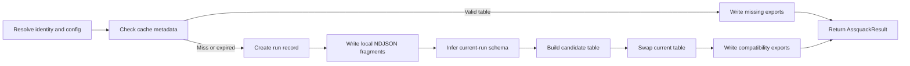

# Materialization Lifecycle

Assquack captures source rows in local NDJSON fragments, lets DuckDB infer a
combined schema across the completed fragment set, builds a typed candidate
table, and transactionally publishes that table as the current asset. Optional
exports happen afterwards.

## Lifecycle At A Glance

1. Resolve the asset identity, table, export target, and runtime configuration;
   select the commit strategy using the declared mode.
2. When `cache_first()` finds a valid run, write only missing exports for that
   run/path/fingerprint, then return the cached table without renewing its TTL.
3. Create a `running` metadata record.
4. Dispatch returned or yielded values to the Python or native relation writer.
5. Write rows into size-controlled local NDJSON fragments.
6. Complete each fragment through an atomic rename, then mark the run directory
   complete after capture succeeds.
7. Use DuckDB to infer the current run schema from completed fragments.
8. Build the typed candidate table directly from the completed fragments.
9. Transactionally replace the current table and mark the run successful.
10. Write configured exports from the committed table.

## Storage Boundaries

The request carries the asset's declared mode into execution. A framework-owned
registry selects its commit strategy before opening the database, and the asset
metadata records that same mode without a separate default. Only `replace` is
supported; unknown modes fail before cache lookup or source capture.

New run IDs follow the MAD.Prefect hash-based identifier pattern:
`hashlib.md5(f"{asset_id}:{runtime.isoformat()}".encode()).hexdigest()`.
The input is UTF-8 text containing the complete asset ID, a colon, and the
captured UTC datetime in Python ISO format (including `+00:00` and any
microseconds). The same datetime is stored in `assquack_meta.runs.runtime`.
The result is a deterministic 32-character lowercase hexadecimal identifier,
safe for local fragment paths. MD5 serves as an identifier, not a security hash.

For example, an asset ID of 64 `a` characters and runtime
`2026-10-22T01:02:03.456789+00:00` produce
`091cf65dcfbef278d3bfe8a5ed142590`.

An identical pair or hash collision is rejected by the run primary key before
capture; it does not overwrite the existing run, fragments, or published table. An existing
fragment directory also causes capture to fail, preserving any orphaned evidence.
Cache hits return the existing run ID, including IDs created by older versions.

The three paths are independent:

- the fragment directory is local working and diagnostic storage;
- the `.duckdb` file contains canonical asset state and metadata;
- an export alias identifies an optional compatibility output.

By default, fragments live under
`fragments/asset=<asset-name>/run_id=<run-id>/` beside the configured database.
Changing an export from local storage to ADLS does not move the fragments or
the database.

## Fragment Capture

`AssquackConfig.ingestion.fragment_target_mb` controls the target byte size of
each fragment. Python inputs stream one record at a time; `chunk_size` does not
control capture or fragment boundaries.
The Python writer counts serialized UTF-8 bytes including each newline, then completes
the fragment after a whole record reaches or exceeds the target. Oversized
records stay intact; capture never creates an empty trailing fragment. See
[Configuration](configuration.md#local-ingestion-fragments) for units and defaults.

The shared Python byte writer accepts mappings and iterables of mappings directly.
DuckDB relations use native `COPY`; pandas DataFrames, Arrow Tables and Arrow
RecordBatches first become relations and use that same writer. COPY size targets
are approximate and may be substantially exceeded. Optional pandas and Arrow
libraries are needed only when supplying their corresponding objects.

Sync and async iterables dispatch each yielded item through its matching route,
including mixed batches. An `AssquackResult` reads its materialized table without
cache lookup or reexecution. An `AssquackAsset` executes normally (including its
cache preference), then follows the result route using the caller's configuration.
Asset authors decode HTTP responses themselves; direct response handling is not
supported. This 29 October approval supersedes earlier HTTP support and pending
pandas/Arrow routing notes in the [writer decisions](journal/2026-09-08-mvp-scope.md#fragment-writer-decisions-28-october-2026).

Direct nested asset execution in the same async task shares the existing database
writer lock. Other tasks and processes still wait. Nested runs retain independent
run records; recovery excludes active runs, and only the outer call releases the
lock. A dependency awaited through a separate task cannot share that lock.

A fragment is first written with a `.partial` suffix. Assquack flushes and
renames it to `.ndjson` only when that fragment is complete. DuckDB receives an
explicit list of completed fragments; partial files are never inference input.
The run directory receives `_COMPLETE` only after source capture finishes.

**Hard requirement: no empty fragments, regardless of input type or writer.**
Empty inputs and empty batches produce no fragment files. Every completed
fragment must contain at least one record. If a native writer such as DuckDB
`COPY` creates empty output files, Assquack must delete those files before
registering completed fragments or marking capture complete. Empty files must
never enter fragment metadata or the schema-inference input list. An empty
extraction remains a valid replacement with zero fragments; `_COMPLETE` is a
run marker, not a fragment.

## Schema And Candidate Table

DuckDB's native JSON reader scans every completed fragment with full sampling,
field union, and nested inference enabled. The configured current-run strategy
resolves its columns without historical schema or detailed observations. Rules
live in [Schema Inference](schema-inference.md).

Fragment reads start with a 32 MiB DuckDB object-size setting. If DuckDB reports
an oversized JSON record, Assquack scans the completed fragments in bounded byte
buffers, measures the largest serialized record and retries the read once using
that size. Later reads in the run reuse the recovered setting. Normal reads need
no extra scan; recovery neither repeats extraction nor rewrites fragments. Other
read errors and a failed retry follow the usual failure behavior below.

The candidate table contains `_qa_run_id`, `_qa_loaded_at`, and the effective
typed columns. Source columns absent from the current extraction disappear. A whole-row `VARIANT` payload is optional rather than a
mandatory staging column.

## Transaction And Failure Behavior

Source capture and JSON scanning do not run inside the final publication
transaction. The short transaction replaces the stable current table and marks
the run successful together, so readers see either the previous asset or the
new one.

On capture or inference failure, the previous current table remains valid and
the run is marked failed. Completed fragments and any partial fragment remain
local diagnostic evidence subject to retention.

### Fragment retention and interrupted runs

After each completed attempt, retain the latest successful run's fragments and
the latest three failed runs' fragments per asset identity, including bound
arguments. A failed refresh never removes the last successful run's fragments
or its published table. Retry always extracts afresh into a new run directory;
it never resumes or combines earlier fragments.

Retention uses catalog status and timestamps, not directory or hash ordering.
Successful runs are ordered by publication time, then runtime; failed attempts
by runtime. Run IDs break exact timestamp ties deterministically.
Metadata, published tables, and export artifacts are not deleted by this policy.

At the next call for an asset, acquiring the exclusive database writer lock
proves that its earlier `running` attempts are no longer active, except direct
nested runs tracked in the current task. Abandoned attempts
are marked failed before cache lookup and retention. Cleanup itself ignores
`running` and unknown runs. No cursor or fragment reuse is introduced.

Cleanup only examines exact catalog-owned run directories under the configured
fragment root, supporting existing UUID and new hash identifiers. New attempts
record directory ownership only after exclusive creation succeeds, so a failed
claim never makes an existing orphan eligible for later deletion. Symlinks,
Windows reparse points, nested directories and unexpected files cause that
directory to be retained with a warning. Missing directories are harmless.
Cleanup failures are logged and retried on a later call; they do not change a
successful publication or replace the original extraction error. Changing the
fragment root leaves evidence in the old root untouched.

An empty extraction is a valid replacement. Assquack publishes an empty table
with only `_qa_run_id` and `_qa_loaded_at`, even when a prior table had source
columns. It does not reuse historical schema.

## Export Phase

Exports read from the committed current table. An export failure can fail the
public call, but it does not roll back the successful table materialization.
Cache state is based on DuckDB metadata and the current table, not fragment or
export existence alone.

## Related Docs

- [Developer API](developer-api.md): asset calls that start materialization.
- [Schema Inference](schema-inference.md): native JSON inference and evidence.
- [Storage Model](storage-model.md): local and durable storage responsibilities.
- [Configuration](configuration.md): fragment and DuckDB settings.
- [Exports](exports.md): compatibility publication after materialization.
