# Materialization Lifecycle

Assquack captures source rows in local NDJSON fragments, lets DuckDB infer a
combined schema across the completed fragment set, builds a typed candidate
table, and transactionally publishes that table as the current asset. Optional
exports happen afterwards.

## Lifecycle At A Glance

```mermaid
flowchart LR
  Resolve[Resolve identity and config] --> Cache[Check cache metadata]
  Cache --> Run[Create run record]
  Run --> Capture[Write local NDJSON fragments]
  Capture --> Infer[Infer and observe schema]
  Infer --> Candidate[Build candidate table]
  Candidate --> Commit[Swap current table]
  Commit --> Export[Write compatibility exports]
  Export --> Result[Return AssquackResult]
```

1. Resolve the asset identity, table, export target, and runtime configuration.
2. Return the current table immediately when `cache_first()` finds a valid run.
3. Create a `running` metadata record.
4. Normalize returned or yielded values in bounded memory chunks.
5. Write rows into size-controlled local NDJSON fragments.
6. Complete each fragment through an atomic rename, then mark the run directory
   complete after capture succeeds.
7. Use DuckDB JSON tooling to infer the combined schema and record observations.
8. Build the typed candidate table directly from the completed fragments.
9. Transactionally replace the current table and mark the run successful.
10. Write configured exports from the committed table.

## Storage Boundaries

The three paths are independent:

- the fragment directory is local working and replay storage;
- the `.duckdb` file contains canonical asset state and metadata;
- an export alias identifies an optional compatibility output.

By default, fragments live under
`fragments/asset=<asset-name>/run_id=<run-id>/` beside the configured database.
Changing an export from local storage to ADLS does not move the fragments or
the database.

## Fragment Capture

`AssquackConfig.ingestion.fragment_max_rows` controls the maximum rows in each
fragment independently of `chunk_size`, which bounds in-memory normalization.
One chunk can contribute to a fragment, and a large chunk can span fragments.

A fragment is first written with a `.partial` suffix. Assquack flushes and
renames it to `.ndjson` only when that fragment is complete. DuckDB receives an
explicit list of completed fragments; partial files are never inference input.
The run directory receives `_COMPLETE` only after source capture finishes.

## Schema And Candidate Table

DuckDB's native JSON reader scans every completed fragment with full sampling,
field union, and nested inference enabled. Assquack separately records bounded
`json_group_structure` and `json_tree` evidence from each fragment. Detailed
rules live in [Schema Inference](schema-inference.md).

The candidate table contains `_qa_run_id`, `_qa_loaded_at`, and the effective
typed columns. Historical columns absent from the current extraction remain in
the table as `NULL`. A whole-row `VARIANT` payload is optional rather than a
mandatory staging column.

## Transaction And Failure Behavior

Source capture and JSON scanning do not run inside the final publication
transaction. The short transaction replaces the stable current table and marks
the run successful together, so readers see either the previous asset or the
new one.

On capture or inference failure, the previous current table remains valid and
the run is marked failed. Completed fragments and any partial fragment remain
local diagnostic evidence for the later retention and recovery policy.

An empty extraction is a valid replacement. Assquack publishes an empty table
with the previous effective schema when one exists.

## Export Phase

Exports read from the committed current table. An export failure can fail the
public call, but it does not roll back the successful table materialization.
Cache state is based on DuckDB metadata and the current table, not fragment or
export existence alone.

## Related Docs

- [Developer API](developer-api.md): asset calls that start materialization.
- [Schema Inference](schema-inference.md): native JSON inference and evidence.
- [Storage Model](storage-model.md): local and durable storage responsibilities.
- [Configuration](configuration.md): fragment and DuckDB settings.
- [Exports](exports.md): compatibility publication after materialization.
