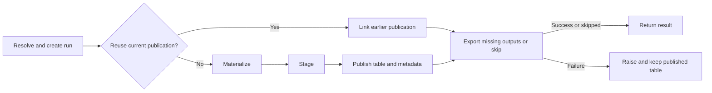

# Architecture and run flow proposal

**9 November 2026 amendment:** credential-provider injection and its async loading
bridge have been removed for the environment-only, single-destination MVP.
Earlier provider discussions below are historical; see the
[simplification decisions](../reviews/2026-11-09-mvp-scope-options.md).

Status: **Implemented with the decisions recorded below; original proposal retained for context**
Date: 2026-11-06

**9 November amendment:** the per-call argument/configuration snapshot guarantees
below are superseded. Calls now bind at execution and use ordinary argument
references, while retaining independent derived options and templates. See
[current argument behaviour](../developer-api.md#call-arguments-and-execution).

Assquack should read as four core objects and five visible stages. An asset
defines work. A request asks for that work. A run records its progress. A result
provides access to the published table. The coordinator should read
**Resolve → Materialize → Stage → Publish → Export**, with cleanup beside the
operations that create resources and in their exception/finally paths.

## Implementation outcome

The authorized refactor is implemented. The proposal below records the design
review; its alternatives and illustrative code are not the final execution contract.
See [phase 08](../epics/01-mvp/08-request-and-run-pipeline.md),
[the lifecycle](../materialization-lifecycle.md) and the
[implemented coordinator](../../src/assquack/_pipeline/__init__.py) for the final behavior.

- The coordinator names Resolve, Materialize, Stage, Publish and Export directly.
- `AssquackRequest` captures arguments and options when the asset is called,
  before its returned coroutine is awaited. Built-in data containers are copied;
  custom objects and live resources retain identity. Producer mutation cannot
  rewrite the request's captured containers.
- `AssquackRun` records stage progress and errors. The existing MD5 run identifiers
  and public result fields are preserved. UUID identifiers and a public
  `invocation_id` were not adopted.
- Cache hits create an active run object but no additional persisted run row.
  The proposal's cache-hit audit rows remain unimplemented.
- Fresh-run stage outcomes are persisted. Publication success remains distinct
  from invocation outcome, so an export failure cannot undo the published table.
- `current_publications` identifies the run occupying a physical table, including
  empty tables, for cache checks and manual export attribution.
- Fragment input handling stays with its writer. Schema inference remains native
  DuckDB inference in storage; schema history is outside this refactor.
- Independent source review approved the implementation: **457 tests passed with
  zero skips**, full Pyright reported zero errors/warnings, and Ruff and formatting
  passed. The six original mutation failures are fixed.

The original source assessment and before-tree below describe the pre-refactor
checkout at `b92e85585f813c3bd97148722946de144326324c`. Removed paths are retained
as historical names rather than broken local links. No changes are committed.

## Reading and decision guide

- [Current assessment](#current-assessment) explains the source evidence.
- [Source layout](#source-layout) shows complete before/after trees and ownership.
- [The invocation story](#the-invocation-story) follows a call through the system.
- [Run metadata](#run-metadata) defines the proposed persisted state.
- [Failure and cleanup](#failure-and-cleanup) explains exceptional paths.
- [Decisions for review](#decisions-for-review) separates recommendations from
  agreed direction and sets out an implementation sequence.

**Agreed direction:** the four core concepts, five stage names, an active
`AssquackRun` before cache lookup, fixed per-stage metadata columns, atomic table
replacement with publication metadata, and cleanup close to the relevant work.
Configuration can be attached through `@asset(config=...)`, overridden through
`assquack_config` at call time, or supplied by normal defaults.

**Agreed layout updates:** the coordinator lives in `_pipeline/__init__.py`,
with one file for each of the five stages. `_storage/fragment_writer.py` handles
the supported producer output types and writes their fragments.
`_storage/schemas.py` uses DuckDB's `DESCRIBE` over fragments and preserves the
inferred types; Stage calls it to build the candidate table. Persisting schemas
for future merge/append work is outside this refactor. Keep `AssquackResult.to_df()`
as an explicit DataFrame request; `.query()` continues to return a DuckDB relation.

**Agreed request guarantee:** rename `MaterializationRequest` to `AssquackRequest`
and make it preserve the arguments and options for one invocation before pipeline
execution. Later mutations must not rewrite that request. Resolve derives identity,
table names and export paths from the same captured values used for execution.

**Recommendations requiring review:** remaining module moves outside the agreed
layout updates above; persisting cache-hit
invocations; run identifiers before resolution completes; the current-publication
table; precise status/error fields; and consolidation of fragment pruning.
These are not recorded as already approved public or storage contracts.

## Current assessment

References below name files and symbols rather than unstable line numbers. Paths
are relative to the repository unless stated otherwise. Source is authoritative
where older epic notes describe a superseded implementation.

| Area | Current responsibility and evidence | Assessment |
| --- | --- | --- |
| Asset and decorator | `_api.py`: `AssquackAsset`, `asset`, `with_arguments`, `with_options`, `_request` | The main domain object is hidden behind a generic filename. One file defines the decorator, option validation, argument binding, identity hashing, table resolution and fluent copies. Split by those actual responsibilities; retain the small fluent methods on the asset. |
| Configuration and templates | [`_config.py`](../../src/assquack/_config.py), [`_templates.py`](../../src/assquack/_templates.py): `AssquackConfig`, `AssetTemplateFormatter` | These have clear purposes. Preserve precedence and original templates. Do not introduce a separate configuration provider or configurator object just to move methods. |
| Request, run and result | `_materialization/models.py`, `_storage/models.py`, [`_result.py`](../../src/assquack/_result.py) | `MaterializationRequest` carries resolved requested work. `SuccessfulRun` is a database read record. `AssquackResult` points to a published table. There is no active `AssquackRun`; local variables, `_ACTIVE_RUNS`, and database rows collectively hold execution state. |
| Pipeline | `pipeline.py`: `materialize`, `_resolve_execution`, `_prepare_asset`, `_try_cached_result`, `_capture_data`, `_prepare_staging`, `_cleanup` | The new helpers explain individual operations. However, resolution still spans the asset and pipeline, cache lookup also performs exports, and `committed` governs a broad failure handler. Stage progress is not persisted. Shortening the coordinator alone does not address these issues. |
| Materialize | `fragments.py`: `write_fragments`, `NDJSONFragmentWriter` | Input dispatch and file writing are substantial real work. Mapping serialization, native relation COPY, nested assets and generator closure deserve named homes. Preserve streaming, unique directories, partial files and the completion marker. |
| Stage | `schema.py`, `staging.py`, `json_reader.py` | Current-run inference, shared measured JSON size limits, and staging SQL form a coherent stage. `ProjectionSpec.source_field` is computed but not used to build columns. `StagingTables` wraps one table. Remove these unused shapes, retaining typed column projections. |
| Publish | `commit.py`: `ReplaceCommitStrategy.publish` | The essential invariant is already sound: replacement, successful run metadata and asset publication dates share one transaction. The `CommitStrategy` name describes a mechanism; `PublicationStrategy` describes its responsibility. Keep the narrow mode boundary, with only replace implemented. |
| Connection and SQL | [`_storage/database.py`](../../src/assquack/_storage/database.py), [`tables.py`](../../src/assquack/_storage/tables.py), [`sql.py`](../../src/assquack/_storage/sql.py) | One shared default connection, qualified table references, and synchronous operation/transaction scopes are useful boundaries. Bootstrap DDL can move beside metadata; table references and identifier quoting should remain small and explicit. |
| Locks | `_storage/locking.py`, `test_writer_lock.py` | The standalone file lock has no production caller now. Its subprocess test tests that utility, not Assquack publication. Recommend deletion when implementing the layout. Keep the shared connection lock and overlapping/nested capture tests. |
| Metadata and cache | [`metadata.py`](../../src/assquack/_storage/metadata.py): `find_latest_successful_run`; `_cache.py`: `find_cached_run` | Publication success currently doubles as run success. Cache asks for the latest success for an asset and checks that the table exists. It does not prove that this asset/run still occupies that table. A new run object alone cannot fix that distinction. |
| Retention | `retention.py`, `MetadataRepository.find_obsolete_fragment_runs` | Recovery and pruning happen before cache lookup; pruning also happens after publication and on failure. The deletion guards are justified. Consolidate when pruning runs, not the safety checks it uses. |
| Exports | [`_exports/operations.py`](../../src/assquack/_exports/operations.py), destination/preparation/authentication modules | Automatic and manual exports already share writing and manifest recording. Preserve that. The nested writer package adds navigation for one implementation; the registries serve a different, documented purpose and should remain. |
| Queries | `_query/asset.py` | Two functions prepend a qualified FROM clause and return a native relation or dataframe. A package plus forwarding initializer is unnecessary for this size. Do not revive the removed SQL parser, qualifier or general query API. |
| Shared types | `_api.py`, `_materialization/models.py`, `_exports/models.py`, `_storage/models.py` | Move types beside the feature that owns them. Retain a small common exception hierarchy. A global utilities/types package would hide ownership again. |

### Current limits to keep separate from responsibilities

These are source-review observations, not newly executed defect reproductions:

- Resolve errors and cache-hit export errors occur before the existing main
  run failure handler. A cache hit creates no invocation row.
- The exception handler catches `BaseException`, which includes cancellation,
  but failure-state writes, table drops or final lock acquisition can themselves
  raise and hide the original error. Fragment abort and pruning already have
  narrower protections; preserve those and close the remaining gaps.
- Run status remains `success` after an export error because publication already
  committed. That correctly preserves the table, but cannot report invocation
  and export outcomes separately.
- A retained result queries the current table. Manual export currently also
  reads that table but records the retained result's old run/count. The accepted
  [DF-002 finding](2026-11-04-repository-review.md)
  also covers argument variants sharing a physical table. The recommendation
  below follows its accepted direction: resolve the actual current publication.
- `chunk_size` is accepted configuration but is not consumed by capture. Removing
  it is a separately reviewable API deletion, not an excuse to change streaming.
- Authentication deliberately replaces sensitive backend diagnostics with safe
  errors. Stage logging must not restore those hidden messages or inspect locals.

### What the historical references actually establish

**MAD.Prefect:** reviewed the actual modules under
[data_assets](../../.submodules/MAD.Prefect/mad_prefect/data_assets/__init__.py),
including `data_asset.py`, `data_asset_callable.py`, `data_asset_run.py`,
`data_artifact.py`, `data_artifact_collector.py`, `data_artifact_query.py`,
`asset_metadata.py`, `asset_decorator.py`, options, templates and the fluent
configurator. The [manifest document](../../.submodules/MAD.Prefect/docs/asset-manifest.md),
[cache document](../../.submodules/MAD.Prefect/docs/data-asset-cache-first.md), and
[formatting document](../../.submodules/MAD.Prefect/docs/data-asset-attribute-formatting.md)
provide context; some contain historical progress statements.

`DataAssetCallable.__call__` constructs `DataAssetRun` before cache lookup.
It returns on a cache hit **before persisting new run metadata**.
`DataAssetRun.persist` writes run JSON and optionally updates the asset manifest.
It does not implement DeltaBase's per-stage lifecycle. Its useful conceptual
separation is definition → invocation → collected fragments → queryable result.
Assquack should retain its own DuckDB table model, typed configuration and
DuckDB-only exports rather than copy artifact serialization or filesystem code.

**DeltaBase:** read with `git show`, without changing the checkout at
`E:/projects/MAD.Data.Xero`, at commit
`ef0005a4677752da5eb198e3602cff9d4e7615b3` (29 August 2025).
The relevant paths are `mad_data_xero/dw/deltabase/__init__.py`, `run.py`,
`ingestor.py`, `recorder.py`, `loader.py`, and `extractor.py`.
This commit was found through all refs; it need not be an ancestor of the current
`feat/deltas` checkout, which no longer has those files.

`DeltaBaseProcessor.process_data` visibly calls ingestion, recording, loading and
extraction. Recorder and loader have local try/except/finally blocks with state
saves before work and after the outcome. Ingestor and extractor manage their own
state. `DeltaBaseRun.save_state` upserts one row per run into `meta.<table_name>`.
The columns `ingest`, `delta_file_creation`, `delta_load`, and `bucket_extract`
use `unstarted`, `pending`, `success`, and `failure`.

The required structure is DeltaBase's visible Recorder/Loader blocks in
`process_data`: set the stage running, save state, do the work, record success,
and catch that stage's failure in the main function. Assquack applies that shape
to all five of its stages in `run_pipeline`. Stage helpers perform the underlying
operations; they do not own stage statuses or exception-to-stage recording.

The initial refactor incorrectly moved those lifecycle blocks into the helpers.
This correction supersedes that choice. The main pipeline also shows Publish's
transaction, so its table replacement and success save remain atomic. Failure saves
are best-effort through `run.fail()` before a bare re-raise, rather than an unguarded
`finally` save that could replace the original error. Local writer closure stays
with the writer operation; final retention and resource release remain visible in
the coordinator.

**Original Assquack history:** `694032db829dbf9c13af029e7c97622bb49b5e51`
explicitly lists `AssquackRun` under Core classes in the original
`docs/assquack-mvp-plan.md`. `f40b131c18b756bd3eb594971de9a7f775759e7b`
adds the style example `materialize_asset(run: AssetRun)`.
`fccd477764f33f00c2cc3ee3ba68e9336bc06686` reinforces the plan's historical
status and directs implementation to active docs. These establish an early run
concept, not an implemented class that was removed. No explicit exclusion of a
run object or historical motive for omitting one was established. Later database
run specifications leave Python organization open.

## Source layout

All current source files are shown, including package initializers and
`py.typed`. No source folder is collapsed. The proposed tree is a review target;
it does not authorize moves or public import changes.

### Before

```text
src/
└── assquack/
    ├── __init__.py
    ├── _api.py
    ├── _cache.py
    ├── _config.py
    ├── _errors.py
    ├── _result.py
    ├── _templates.py
    ├── py.typed
    ├── _materialization/
    │   ├── __init__.py
    │   ├── commit.py
    │   ├── fragments.py
    │   ├── json_reader.py
    │   ├── models.py
    │   ├── pipeline.py
    │   ├── retention.py
    │   ├── schema.py
    │   └── staging.py
    ├── _storage/
    │   ├── __init__.py
    │   ├── database.py
    │   ├── locking.py
    │   ├── metadata.py
    │   ├── models.py
    │   ├── sql.py
    │   └── tables.py
    ├── _query/
    │   ├── __init__.py
    │   └── asset.py
    └── _exports/
        ├── __init__.py
        ├── models.py
        ├── operations.py
        ├── targets.py
        ├── authentication/
        │   ├── __init__.py
        │   ├── azure.py
        │   ├── base.py
        │   ├── credentials.py
        │   ├── local.py
        │   └── registry.py
        ├── destinations/
        │   ├── __init__.py
        │   ├── base.py
        │   ├── filesystem.py
        │   └── fingerprint.py
        ├── preparation/
        │   ├── __init__.py
        │   ├── azure.py
        │   ├── local.py
        │   └── registry.py
        └── writer/
            ├── __init__.py
            └── file.py
```

### Proposed after

```text
src/
└── assquack/
    ├── __init__.py
    ├── _asset.py
    ├── _decorator.py
    ├── _options.py
    ├── _request.py
    ├── _run.py
    ├── _result.py
    ├── _config.py
    ├── _templates.py
    ├── _query.py
    ├── _errors.py
    ├── py.typed
    ├── _pipeline/
    │   ├── __init__.py
    │   ├── resolve.py
    │   ├── materialize.py
    │   ├── stage.py
    │   ├── publish.py
    │   └── export.py
    ├── _storage/
    │   ├── __init__.py
    │   ├── database.py
    │   ├── tables.py
    │   ├── sql.py
    │   ├── metadata.py
    │   ├── records.py
    │   ├── catalog.py
    │   ├── cache.py
    │   ├── schemas.py
    │   ├── fragment_writer.py
    │   ├── json_reader.py
    │   └── retention.py
    └── _exports/
        ├── __init__.py
        ├── models.py
        ├── resolution.py
        ├── operations.py
        ├── targets.py
        ├── writer.py
        ├── authentication/
        │   ├── __init__.py
        │   ├── azure.py
        │   ├── base.py
        │   ├── credentials.py
        │   ├── local.py
        │   └── registry.py
        ├── destinations/
        │   ├── __init__.py
        │   ├── base.py
        │   ├── filesystem.py
        │   └── fingerprint.py
        └── preparation/
            ├── __init__.py
            ├── azure.py
            ├── local.py
            └── registry.py
```

The five stage files contain the operations performed by each stage. The main
pipeline owns their status assignments, state saves and stage-specific error blocks. `_pipeline/__init__.py` coordinates them.
`materialize.py` calls the producer and passes its output to
`_storage/fragment_writer.py`, which handles the supported input types and writes
their fragments. Keep `write_fragments` and `NDJSONFragmentWriter` together;
there is no separate `inputs.py`. There is no separate object for every stage
and no generic stage engine.

### Core object ownership

| Object | Holds | Does | Does not own |
| --- | --- | --- | --- |
| `AssquackAsset` | Producer, original templates, declared options, bound arguments, optional attached config | Creates immutable configured copies; offers call/query/exists entry points | Invocation status, database transactions, open writers |
| `AssquackRequest` | Producer reference and a snapshot of the invocation's arguments and options | Preserves what was requested before pipeline execution; supplies stable values for resolution and execution | Stage progress, counts, errors or database access |
| `AssquackRun` | Request reference, ID/start time, resolved call arguments/config/identity/table/targets, stage statuses, counts, fragment paths, publication link and error summary | Holds active execution state and validates state transitions | Producer implementation, SQL, credentials in serialized state, result querying |
| `AssquackResult` | Config/table reference, originating asset/publication ID and count, invocation ID, cached flag | Queries the current table; delegates manual export | Active execution, historical table snapshots, stage mutations |

This changes the internal request from already-resolved execution arguments to
a snapshot of the requested invocation. Request creation binds supplied and
previously bound arguments, applies function defaults and captures the values
before the pipeline starts. Resolve uses that snapshot to format templates and
derive identifiers; it must not reread mutable arguments or options from the caller
or asset. The run holds execution state separately from the request's original
values. Credentials and destination objects remain transient and excluded from
run persistence/repr. Prefer a typed dataclass for active state and a separate
typed storage record; do not serialize the entire object graph.

Keep `AssquackRun` and `AssquackRequest` internal initially. Their names
make source navigation clear without committing to public stage mutation or
execution APIs. Keep public imports in `assquack.__init__`; underscore filenames
continue to signal private implementation.

### Request snapshots and mutation tests

MAD.Prefect deep-copies options in `DataAsset.__init__` so formatting one derived
asset cannot alter its siblings. Its fluent configurator reuses original templates
and base options when constructing derivatives. It binds arguments with
`functools.partial`; it does not deep-copy call arguments. These protections were
introduced in commit `302fd078c5a69c0972dc4db76d4eac8ba17b7e8c` alongside attribute
formatting tests and documentation.

Assquack must preserve those option protections and extend them to the request's
call arguments. A frozen dataclass alone is insufficient: nested dictionaries and
lists can still change. Capture supported mutable values without leaving shared
references that let later caller changes rewrite an earlier request. Producer
execution must also leave the request's recorded original values intact.

The tests were added before refactoring in
[`test_request_snapshot.py`](../../tests/test_request_snapshot.py). They currently
have three passing cases and six failing cases:

| Acceptance case | Current result |
| --- | --- |
| Sibling assets retain independently formatted options | Pass |
| Option overrides preserve earlier requests and original templates | Pass |
| Mutating the supplied export declaration cannot rewrite requests | Pass |
| Nested positional, keyword, bound and default arguments retain their captured values | Four failures |
| Nested keyword-only arguments retain their captured values | Fail |
| Reusing a dictionary for another call cannot rewrite the first request | Fail |

All nine cases must pass after implementation. In the repeated-call failure, the
first request still names the `orders` table and export but its argument has
changed to `customers`. The snapshot must keep arguments, identity and resolved
destinations consistent. These tests exercise the current request API so their
failures expose mutation, rather than the absence of the proposed class name.

Define copying for supported values explicitly. Do not blindly deep-copy producers,
assets, generators, database connections or other runtime resources. Configuration
is currently passed separately; specify how effective settings are captured without
copying live resources or persisting credentials. Add execution-side mutation tests
when implementing the producer handoff; the current tests cover caller-side changes.

### Module ownership and move map

| Proposed module or exact retained group | Move/merge/add | Responsibility |
| --- | --- | --- |
| `__init__.py`, `py.typed` | Retain | Public exports, existing conditional import initialization, typing marker. |
| `_asset.py` | Split `_api.py` | Define `AssquackAsset` and its short fluent/call/query/exists methods. |
| `_decorator.py` | Split `_api.py` | Validate the decorator declaration and construct an asset. |
| `_options.py` | Split `_api.py` and request models | Define `AssetMode`, the unset sentinel and shared option validation. Keep original template values in a small immutable definition record. No configurator hierarchy. |
| `_request.py` | Rename and extend `MaterializationRequest` | Define `AssquackRequest`; bind arguments, apply defaults and capture arguments/options before execution. No database access. |
| `_run.py` | Add | Define active run state, stage/status types and explicit state-change methods. Persistence remains in the repository. |
| `_result.py` | Retain | Provide current-table access through `.query()`, explicit DataFrame conversion through `.to_df()`, and manual exports. |
| `_config.py` | Retain | Validate config and environment/default settings; preserve attached/call/default precedence. |
| `_templates.py` | Retain | Partial and strict formatting, including nested asset arguments. Import from `_asset`, not `_api`. |
| `_query.py` | Merge `_query/asset.py` and forwarding initializer | Return a DuckDB relation for `.query()`. Fetch a pandas DataFrame only when `.to_df()` is called. |
| `_errors.py` | Retain | Common public error ancestry and schema warning. Do not create miscellaneous helpers here. |
| `_pipeline/__init__.py` | Move coordinator | `run_pipeline` visibly owns each stage's running/success assignments, state saves, try/except failure block, Publish transaction, cache branches and final cleanup. |
| `_pipeline/resolve.py` | Merge resolution helpers and template/identity work from `_request` | Resolve captured request values into mode/table and export destinations, open metadata, recover abandoned states and choose cache reuse. The main pipeline creates the run and records Resolve progress. Also expose pure resolution usable by `asset.exists()` without starting an invocation. |
| `_pipeline/materialize.py` | Move `_capture_data` and writer setup | Claim the new directory; call/await the producer; pass its output to the fragment writer; finish fragments; close the writer locally. Stage state and failure recording stay in the main pipeline. |
| `_pipeline/stage.py` | Merge `_prepare_staging` and `staging.py` | Call `_storage/schemas.py` for the inferred columns and types and build the candidate table. The main pipeline records Stage progress and failure. |
| `_pipeline/publish.py` | Move/rename `commit.py` | Replace the table and publication metadata inside the transaction opened by the main pipeline. The main pipeline saves Publish success in that transaction and catches rollback failures. |
| `_pipeline/export.py` | Add from coordinator/cache branch | Call shared export operations. The main pipeline records Export progress, failure or skipped status. |
| `_storage/database.py` | Retain | Attach databases, maintain shared engine settings, coordinate synchronous operations and transactions. |
| `_storage/tables.py`, `_storage/sql.py` | Retain except bootstrap DDL | Table references, existence/schema operations and SQL quoting. |
| `_storage/catalog.py` | Extract bootstrap DDL from `tables.py` | Create and validate the metadata schema; reject incompatible existing shapes clearly. |
| `_storage/metadata.py` | Retain and extend | Save typed run state, register assets, update/read current publications, record exports and select retention candidates. No producer or file deletion. |
| `_storage/records.py` | Rename `models.py` | Typed asset/run/publication/export database records; replace `SuccessfulRun` with `PublicationRecord`. |
| `_storage/cache.py` | Move `_cache.py` | Check the actual current publication, asset identity, table presence and publication TTL. Shared with `exists()`. |
| `_storage/schemas.py` | Move inference from `schema.py` and `staging.py` | Use DuckDB's `DESCRIBE` over this run's fragments and return the inferred columns and types unchanged. Remove unused JSON source-path construction. Schema persistence for merge/append is future work. |
| `_storage/fragment_writer.py` | Move `fragments.py` | Keep `write_fragments`, `NDJSONFragmentWriter`, fragment records and run paths together. Handle mappings, native relations, pandas/Arrow, assets/results and iterables; write/finish/abort fragments and close failed generators in the consuming task. |
| `_storage/json_reader.py` | Move | Build DuckDB `read_json` SQL and handle the bounded retry for oversized records. Shared by inference and staging; DuckDB itself infers the schema. |
| `_storage/retention.py` | Move | Select through metadata and safely remove obsolete owned fragment directories. |
| `_exports/resolution.py` | Move logic out of `_exports/__init__.py` | Copy destinations, resolve ordered targets, reject conflicting paths and release captured inputs. |
| `_exports/operations.py` | Retain | Write ordered exports and record each success; coordinate manual export using the actual current publication. |
| `_exports/models.py` | Retain; receive export types from `_api.py` | Define `ExportTarget`, `ExportFormat`, `ExportSpec`. No runtime work. |
| `_exports/targets.py` | Retain | Expand aliases/pipes/formats into targets. |
| `_exports/writer.py` | Merge `writer/file.py` and remove its initializer | Keep the single `DuckDBFileWriter`; validate fixed format options and execute COPY. No replacement-writer registration. |
| `_exports/destinations/base.py`, `filesystem.py`, `fingerprint.py` | Retain | Destination contract/private state; filesystem composition; deterministic configuration fingerprints, respectively. |
| `_exports/authentication/base.py`, `registry.py`, `credentials.py`, `local.py`, `azure.py` | Retain | Authenticator contract; selection; provider input loading; no-auth scope; Azure temporary-secret scope, respectively. |
| `_exports/preparation/registry.py`, `local.py`, `azure.py` | Retain | Scheme selection/protocol; local path/setup; Azure path validation/extension preparation, respectively. |
| Remaining `__init__.py` files shown after | Retain or add only for packages | Package descriptions and deliberate re-exports. Move execution logic to named modules. |
| `_storage/locking.py` | Remove | No production caller remains; do not imply multi-process publication through its isolated tests. |
| `_materialization/models.py`, `_api.py`, old `_query` and writer packages | Remove after moves | Every responsibility is assigned above. No compatibility forwarding modules. |

### Why retain the export layers?

The [27 October decision](../epics/01-mvp/06-extensibility-defects.md)
explicitly retains preparation and authentication registries and rejects replacing
them with if/elif dispatch. The current code and
[`test_export_destinations.py`](../../tests/test_export_destinations.py) also show
real substitution and isolation requirements. This review recommends retaining
that design, while removing the single-implementation writer directory.

| Boundary | Concrete job | Judgment |
| --- | --- | --- |
| Destination | Resolve a declaration and export a table to its targets | Keep the public extension point and private operation copies. |
| Preparation registry | Select local/file or Azure setup from URI scheme | Keep; scheme selection is independent of credentials. |
| Preparation implementation | Normalize/validate paths; create local parent directories or load Azure | Keep distinct from writing. Do not add another filesystem adapter. |
| Authentication registry | Select compatible complete input sets in registration order | Keep the 6 November rule: chain before SAS for auto; explicit choice does not fall back. |
| Credential provider | Load and return selected inputs once | Keep internal injection, including async load/sync access. Do not expose a new public provider API. |
| Authenticator | Create/drop a temporary secret around COPY | Keep local try/finally and safe errors; it has a real resource lifetime. |
| Fingerprint | Identify resolved config independently of the output path | Keep deterministic input handling and lifetime cleanup; never persist raw inputs. |
| Writer | Execute DuckDB COPY for supported formats | Keep one implementation. A factory, registry or adapter would add no current capability. |
| Pipeline Export | Save this invocation's Export progress | Keep separate from shared writes so manual export does not rerun the pipeline or rewrite an old invocation. |

Do not merge credential loading, authentication and file writing merely because
all relate to exports. Their tests and lifetimes differ. Conversely, a package
containing only the one writer has no comparable justification. Keep small
related classes together when they express one feature; file count is not a goal.

## The invocation story

### Definition and partial formatting

`@asset("sales.orders_{region}", config=config, export="orders_{region}.parquet")`
creates an `AssquackAsset`. It validates declaration-level options and keeps the
original templates. Known defaults and bound arguments can partially format
displayed values at definition/import time. Missing placeholders remain until
strict call-time resolution. `with_arguments` and `with_options` create new
definitions and reapply originals; they do not mutate siblings or execute sources.

Constructing an ordinary Python config or decorating an asset is lazy. Separately,
the package initializer currently attaches a database when process placement
variables request it. Preserve that explicit distinction; do not describe all
imports as free of database effects or move attachment into decorators.

### Resolve

`AssquackAsset.__call__` builds an `AssquackRequest`, capturing arguments and options,
then delegates to `run_pipeline`.
Resolve owns the whole call-time resolution story. Its first action constructs
`AssquackRun`, captures UTC start time and sets Resolve to `running` in memory.
The recommendation is a UUID hex run ID, independent of asset identity, so even
an unresolved call can be correlated in logs. This deliberately changes the
current timestamp/asset MD5 contract and its known-digest tests; it needs review.

Resolve selects call config → attached config → `AssquackConfig()` defaults.
Using the request's captured arguments and defaults, it strictly formats templates, calculates the
existing asset identity, validates/sanitizes the table and selects replace mode.
The request retains the producer reference. Execution uses values derived from
the same snapshot without changing its recorded originals. Do not change identity
hashing as part of these moves.

Once config and asset identity are known, open the destination and save the first
run row with Resolve running, before resolving export destinations. Register the
asset, qualify the table, and recover interrupted prior invocations under the
connection lock. Resolve destinations outside a shared connection lock; their
provider may bridge async loading. Reenter a synchronous scope for cache lookup.
Save Resolve success with the reuse decision. On a hit, retain that scope through
the cached export, so another coordinated thread cannot replace the selected
publication between lookup and writing. On a miss, leave it before calling the
producer. Keep destination lifetime open through export and release it on every exit.

This ordering intentionally differs from today: a destination resolution error
can now leave a failed Resolve row and may create the local database first.
Current tests asserting no database exists after provider failure must change
only if this proposed behavior is accepted.

If config, identity or database access fails before a metadata destination exists,
log the run ID and Resolve failure and re-raise. Do not invent an asset identity,
write into an arbitrary default database, or create fallback JSON logs. Such a
failure has no DuckDB row. Declaration/import failures occur before an invocation
and likewise have no run row. A failed state save can also leave incomplete
metadata; logs must state that limit honestly.

`asset.exists()` uses the same pure argument/config/table resolution functions
and current-publication lookup, without creating a run or resolving exports.
`asset.query()` performs a normal invocation and delegates to its result.

### Cache decision

The proposed branch below shows why a cache hit can skip three stages and still
need Export. Publish success commits the table before any export outcome.



Recommend **persisting every invocation that reaches a usable metadata
destination**, including cache hits. Object creation before cache lookup is
agreed; persisting cache-hit invocations is a new behavior recommendation.

On a hit, link the invocation to the earlier publication. Mark Materialize,
Stage and Publish `skipped`; create no fragment directory. Export may still run
to write missing outputs. If all outputs already have completion records, or
automatic exports are disabled, mark Export `skipped`. Do not renew publication
time, change row provenance or attach fragment ownership to the new invocation.

On a miss, continue to Materialize. Resolve no longer calls exports itself and
does not return a result from inside a cache helper.

### Materialize

Save `materialize_status=running` before constructing the writer. Exclusively
create the run directory, then record `fragments_owned=true`. If claiming it
fails, close the writer; do not claim or delete a pre-existing directory.

Call the producer, await its result when needed, and pass the output to
`_storage/fragment_writer.py`. The fragment writer handles each returned or
yielded value. Python mappings stream into NDJSON. Native relations use DuckDB
COPY; pandas/Arrow adapt to relations only when those inputs are supplied.
Nested assets execute normally; results read their current tables. Keep the
current same-task generator closure on error/cancellation.

No shared database lock spans a producer await or async iteration. Native COPY
can take the lock for its own synchronous operation. Finish files and the
completion marker, store the completed file list/count and save Materialize
success. This stage does not infer columns or replace any table.

### Stage

Save Stage running, call `_storage/schemas.py` to run DuckDB's `DESCRIBE` over
this run's completed fragments, and build one candidate table from the inferred
columns and types. Share the measured JSON object limit between inference and
loading. Keep current-run inference and native types, including inferred `JSON`;
empty input produces the existing metadata-only empty shape. Save Stage success.

`_storage/json_reader.py` supplies the `read_json` SQL and reader settings used
for both inference and loading. DuckDB infers the types; Assquack does not replace
them with custom types. This refactor does not persist schemas or add schema
history tables. Future merge/append work can add schema storage in
`_storage/schemas.py` when that behavior is designed.

The Stage work helper creates the candidate. Publish consumes it; the
coordinator drops it in final cleanup on either success or failure.
Pass a named `candidate_table` reference rather than `StagingTables.shaped`.

### Publish

Save Publish running outside the replacement transaction. In one transaction:
replace the asset table, save `publish_status=success`, set the publication time
and row count, update first/last asset publication dates, and update the physical
table's current-publication record. Commit all of them together.

The main pipeline sets the in-memory Publish status to success immediately before
saving it inside the transaction. If that save or COMMIT fails, its Publish
exception block resets the status to failed and records failure after rollback.
No await occurs in this scope. A rollback leaves the prior table and
current-publication link unchanged.

Drop the candidate in final cleanup, logging a cleanup problem without invalidating
the published data. Keep Stage → Publish → automatic Export in the existing
continuous synchronous connection scope. That prevents another coordinated
publication from replacing the table between its commit and export. No await
belongs in that scope.

### Export and return

Save Export running before the first needed write. Write targets in their current
order using DuckDB. After each complete output and required secret cleanup, save
its completion record. Cache retries skip outputs already recorded for the same
publication/path/fingerprint. Save Export success after all required writes;
save skipped if there were none. An output error saves Export failed and raises,
while Publish remains successful and cache eligibility remains intact.

Finish invocation outcome and perform final retention cleanup. Return a result
only when the invocation completes successfully, preserving today's raising
behavior on automatic export failure. `result.run_id` continues to identify the
publication that supplied the result; add `result.invocation_id` for this call.
On a miss they are equal. On a hit they differ. A clearer future rename to
`publication_run_id` is optional API discussion, not necessary for the design.

### Querying and manual export later

`result.query()` remains a live table reference and returns a lazy native relation.
It neither restarts the pipeline nor guarantees historical rows. The result's
original count/ID describe the publication returned at creation, not a snapshot
that subsequent table replacement must preserve.

For manual export, look up the table's actual current publication under the same
synchronous lock used for writing. Use that publication's asset ID, name, run ID
and count for target defaults and export records. Do not falsely attach newer
rows to the old result. Do not reject a result merely because it is old. If the
table exists without known publication metadata, fail clearly rather than invent
provenance. Manual export creates export records with no pipeline invocation ID;
it does not rewrite the old run's stage statuses.

### Map existing operations to the agreed stages

| Agreed stage | Current operations included | Key ownership change |
| --- | --- | --- |
| Resolve | `_api._request`, config choice, `_resolve_execution`, `_prepare_asset`, cache qualification | One stage owns strict resolution and run creation. Separate recovery from deletion and cache lookup from writing exports. |
| Materialize | Writer setup/claim, `_capture_data`, `write_fragments`, `finish` | Record visible start/outcome; keep all producer execution and fragment capture here. |
| Stage | `_prepare_staging`, schema strategy, `create_shaped_staging` | Record inference/loading progress as one Stage outcome. |
| Publish | `strategy.publish`, atomic success metadata | Add current-publication identity in the same transaction. |
| Export | `write_exports` from fresh and cache paths | One automatic stage, including skipped outcomes. Shared writer remains usable manually. |

Earlier multi-step lifecycle lists describe operations within these stages.
Earlier six-stage suggestions are superseded by the preference for local cleanup.
There is no sixth sequential cleanup stage or sixth status column in this proposal.

## Illustrative pipeline shape

The coordinator deliberately follows DeltaBase's visible stage-by-stage structure.
Read this function alone to see each stage's running state, save, operation,
success save and failure handler. Helpers do the work without owning the lifecycle.
The excerpt below matches the implementation; its imports and cleanup helper live
in [`_pipeline/__init__.py`](../../src/assquack/_pipeline/__init__.py).

```python
async def run_pipeline(request: AssquackRequest) -> AssquackResult:
    """Run each stage and record its progress, success or failure here.

    The work helpers do not manage stage outcomes. Publication and its success
    record commit together; a later export failure leaves that table available.
    """
    run = AssquackRun(request)
    resources = ExitStack()
    try:
        # 1. Resolve the captured call, check the cache and prepare exports.
        try:
            run.resolve_status = "running"
            run.save_state()
            exports = resolve(run, resources)
            run.resolve_status = "success"
            run.save_state()
        except BaseException as error:
            run.fail("resolve", error)
            raise

        # 2. Materialize the producer's output into completed fragment files.
        # No database lock spans producer code, which may await other assets.
        if run.cached is None:
            try:
                run.materialize_status = "running"
                run.save_state()
                await materialize(run)
                run.materialize_status = "success"
                run.save_state()
            except BaseException as error:
                run.fail("materialize", error)
                raise
        else:
            run.materialize_status = "skipped"

        # Keep the table unchanged between staging, publication and exports.
        # These operations are synchronous and do not await producer code.
        with database_operation(run.config) as connection:
            # 3. Stage the fragments using DuckDB's inferred columns and types.
            if run.cached is None:
                try:
                    run.stage_status = "running"
                    run.save_state()
                    stage(run)
                    run.stage_status = "success"
                    run.save_state()
                except BaseException as error:
                    run.fail("stage", error)
                    raise
            else:
                run.stage_status = "skipped"

            # 4. Publish the table and its success metadata in one transaction.
            if run.cached is None:
                try:
                    run.publish_status = "running"
                    run.save_state()
                    with transaction(connection):
                        publish(run)
                        run.publish_status = "success"
                        run.save_state()
                except BaseException as error:
                    run.fail("publish", error)
                    raise
            else:
                run.publish_status = "skipped"

            # 5. Export the publication, retaining each completed file's record.
            try:
                if exports:
                    run.export_status = "running"
                    run.save_state()
                    export(run, exports)
                    run.export_status = "success"
                else:
                    run.export_status = "skipped"
                run.save_state()
            except BaseException as error:
                run.fail("export", error)
                raise

            # A failed final save must not falsely mark a completed stage failed.
            try:
                run.outcome = "success"
                run.save_state()
            except BaseException as error:
                run.fail(None, error)
                raise

        return AssquackResult(
            config=run.config,
            asset_id=run.resolved.asset_id,
            asset_name=run.resolved.asset_name,
            run_id=run.cached.run_id if run.cached else run.id,
            table=run.resolved.table,
            row_count=run.row_count,
            cached=run.cached is not None,
        )
    finally:
        cleanup(run)
        try:
            resources.close()
        except Exception:
            _LOGGER.warning(
                "Could not release export destinations for run %s",
                run.run_id,
                exc_info=True,
            )

```

The five blocks are explicit rather than callbacks dispatched by a stage runner.
`run.fail(stage, error)` records the named failure, attaches a stage/run note to the
original exception and attempts to persist it without masking that exception.
The main function then re-raises it with its original type and traceback.

There are three necessary lifetime details. Resolve's first state save is in
memory until its metadata row exists; creating that row records Resolve running.
On a cache hit, Resolve retains the database lock in the main-owned `ExitStack`
until exports finish. On a fresh run no lock spans Materialize's producer await.
Publish's success state is saved inside the main function's transaction so a
failure rolls back the table, publication records and stage success together.

Resource-local cleanup, such as closing the fragment writer, stays beside the
operation that created the resource. Final candidate cleanup, retention and
export destination release are visible in the main function's `finally` path.
Cleanup failures are logged without replacing an earlier execution error.

## Run metadata

### State vocabulary

Recommend `resolve_status`, `materialize_status`, `stage_status`,
`publish_status`, `export_status`, each a non-null `VARCHAR` constrained to
`unstarted`, `running`, `success`, `failed`, `skipped`. Use one matching Python
Literal/enum definition and typed storage mapping. `running` and `failed` fit
Assquack's existing names better than DeltaBase's `pending` and `failure`.
DuckDB-specific ENUM types are unnecessary for five fixed columns.

`unstarted` means the invocation never reached the stage, usually because an
earlier stage failed. `skipped` means the stage was deliberately unnecessary.
Do not mark stages after a failure skipped. Save running before work and the
outcome immediately afterwards. Status columns report progress, not percentages;
per-stage event/timing tables are not proposed.

Add `invocation_status` with `running`, `success`, `failed`. It reports whether
the requested call completed. Publication success is exactly
`publish_status='success'`, even if invocation/export later failed. A successful
cache-hit invocation has Publish skipped and a link to another run's publication.
Avoid another redundant boolean for publication success.

### Tables and columns

Use the existing database-local `assquack_meta` schema. This is proposed DDL
direction; no metadata schemas were changed during this review.

| Table | Proposed shape and purpose |
| --- | --- |
| `assets` | Retain current definition fields and nullable first/last materialized timestamps. These describe an asset identity's publications, not every invocation. |
| `runs` | One row per persisted invocation, including cache reuse. Retain `run_id VARCHAR PRIMARY KEY`, `asset_id VARCHAR NOT NULL`, `runtime TIMESTAMPTZ NOT NULL`; replace ambiguous `status`/`error` with the columns below. |
| `current_publications` | Add one row per physical table in this database: normalized `schema_name`, `table_name` composite primary key, and `publication_run_id VARCHAR NOT NULL`. Join runs for owner, timestamp and count. Update only in Publish's transaction. |
| `exports` | Retain target/format/options/fingerprint/count/time fields. Rename current `run_id` to `publication_run_id`; add nullable `invocation_id` for the automatic call that wrote it. Manual export leaves it null. Each row still means a completed output, not an attempted write. |

`runs` fields in addition to its identifiers/start time:

| Column(s) | Type/default | Meaning |
| --- | --- | --- |
| `invocation_status` | Constrained `VARCHAR`, `running` | Overall call outcome. |
| Five stage columns | Constrained `VARCHAR`, `unstarted` | Fixed pipeline progress. |
| `publication_run_id` | Nullable `VARCHAR` | Self after successful Publish; earlier run on cache reuse; null before any usable publication is selected. |
| `materialized_at` | Nullable `TIMESTAMPTZ` | Set only by this invocation's own successful publication. Cache hits leave it null. |
| `finished_at`, `duration_ms` | Nullable `TIMESTAMPTZ`, `BIGINT` | Invocation end and full elapsed duration, including export. Current duration ends at publication; this is a deliberate semantic change. |
| `row_count` | Nullable `BIGINT` | Captured rows for this invocation; valid publication count only when Publish succeeded. Cache-hit rows leave it null and read the linked publication's count. |
| `fragments_owned` | `BOOLEAN NOT NULL DEFAULT false` | True only after exclusive directory creation and claim. Never true on cache hits. |
| `failed_stage` | Nullable constrained `VARCHAR` | First failing stage; one of the five names. Null for failures outside stage work, such as final invocation-save failure. |
| `error_type`, `error_message` | Nullable `VARCHAR` | Qualified exception type and bounded safe message, replacing the ambiguous single error field. |

Keep `RunRecord` independent of transient execution resources. The active object
can use `MetadataRepository.save_run(record)` through a small `save_state(run)`
function. Do not make it open its own connection or upsert arbitrary whole-object
JSON. Reserve insertion for a new ID; subsequent saves update that row. A duplicate
ID must fail, never overwrite another invocation. The existing orphan-directory
and active-run protections remain necessary even with UUIDs.

`current_publications` is required to distinguish the table's current owner from
the latest successful historical run of an asset. This also works for empty
tables, where `_qa_run_id` cannot be read from a row. Store names normalized with
the existing DuckDB identifier rules; database identity is implicit in the
metadata catalog, not copied as an attachment alias. The publication link must
point to a run with Publish success in that same database. Application validation
and atomic writes enforce the link; do not introduce cascaded history deletion.

### Example final rows

Short IDs below are illustrative. R/M/S/P/E mean the five status columns in order.

| Invocation | R | M | S | P | E | Invocation outcome | Publication link | Failed stage |
| --- | --- | --- | --- | --- | --- | --- | --- | --- |
| `A`: fresh success | success | success | success | success | success | success | A | null |
| `B`: cache hit, all outputs complete | success | skipped | skipped | skipped | skipped | success | A | null |
| `C`: cache hit, writes missing output | success | skipped | skipped | skipped | success | success | A | null |
| `D`: source raises | success | failed | unstarted | unstarted | unstarted | failed | null | materialize |
| `E`: staging raises | success | success | failed | unstarted | unstarted | failed | null | stage |
| `F`: replacement rolls back | success | success | success | failed | unstarted | failed | null | publish |
| `G`: export raises after new publication | success | success | success | success | failed | failed | G | export |
| `H`: cache retry export raises | success | skipped | skipped | skipped | failed | failed | G | export |
| `I`: destination resolution raises after row creation | failed | unstarted | unstarted | unstarted | unstarted | failed | null | resolve |

A fresh run with automatic exports disabled has Export skipped. Rows B/C/H own
no fragments and have no new `materialized_at`. G has a publication timestamp
and is cache eligible while its table remains current. Export records from
successful outputs of G/H point to G; their optional invocation IDs distinguish
which call wrote them. D/E/F do not replace the previous current-publication row.

While Materialize is executing, a typical row is Resolve success, Materialize
running, later stages unstarted, invocation running. A process crash can leave
that exact row for recovery; the database does not pretend to know its outcome.

### Cache and export queries

Replace `WHERE asset_id=? AND status='success' ORDER BY materialized_at DESC`
as the cache authority. Look up the requested physical table in
`current_publications`, join its run, require that run's `asset_id` matches the
request and `publish_status='success'`, verify table presence, and apply TTL to
that publication's `materialized_at`. A newer cache-hit row or export failure
does not move the TTL. Changing a table while keeping an explicit asset name
cannot redirect a historical success to an unrelated table.

Export completion queries use the actual `publication_run_id`, resolved URI and
destination fingerprint, preserving current retry semantics. No cache-hit run
can become an export's data owner. Direct external SQL replacement can still
invalidate Assquack metadata; this proposal does not add monitoring or hashing
of arbitrary external writes. Coordinated Assquack publications are the contract.

### Transaction boundaries

| Operation | Save boundary |
| --- | --- |
| Resolve/Materialize/Stage start and outcome | Short synchronous metadata writes before/after work; no transaction across producer awaits. |
| Publish start | Save running before BEGIN so it survives a replacement rollback. |
| Table replacement and Publish success | One transaction includes replacement, run success/count/time/self-link, asset dates and current-publication pointer. |
| Export | Outside the publication transaction; record each successful file separately. File writes and DuckDB rows are not a distributed transaction. |
| Invocation finish | Separate final save; failure here cannot undo a committed publication. |
| Cleanup | Resource-local operations and one final retention pass; no rewriting publication success. |

If a file write succeeds but its export-record insert fails, retry can write that
output again. This is an honest existing limitation, not a reason to add a
distributed transaction or a new recovery service.

## Failure and cleanup

### Preserve the original failure

Each stage-specific `except` block in the main pipeline calls `run.fail` with
the stage name and original exception. That method logs the stage and run ID,
marks the stage failed in memory and attempts the failed-state write. Log the original traceback using
the exception object without capturing locals. Re-raise with bare `raise` so
callers retain the original type and traceback, including cancellation.

Keep existing authentication redaction: raw backend exceptions can contain signed
URLs. At that boundary, the safe raised error and safe traceback are authoritative
for pipeline logging; do not walk suppressed causes/contexts to recover secrets.
Do not persist producer arguments, credentials or full traceback text into runs.
Bound `error_message` (recommend the existing 4,000-character limit) and document
that persistence of an error summary is best effort when DuckDB itself fails.

Failure-state saving, rollback, writer closure, destination release, candidate
drop and active-run removal must each preserve an already-active exception.
Secondary ordinary cleanup errors are logged separately, not raised over it.
Do not catch cancellation and convert it to a successful result; record its
exception type when possible and re-raise it. Preserve same-task async generator
closure. Do not add asynchronous background finalizers or retry loops here.

On a successful data path, failure to save a required stage state aborts the call;
it is an execution failure, not cosmetic cleanup. After publication, even such
a failure must leave Publish success intact. Best-effort file pruning and candidate
dropping remain warning-only. The database may retain an invocation as running
if the final failure write cannot succeed; that is a recovery case, not proof
that publication failed.

### Recover interrupted state separately from deleting files

Keep recovery in Resolve under the connection lock, scoped to the resolved asset
and database and excluding in-process active run IDs. Register the current run
before it can be mistaken for abandoned work. The shared default connection
retains the existing single-process writer assumption; do not infer liveness
from a timeout or add a lease protocol.

For an abandoned invocation, preserve every completed stage. Mark a persisted
running stage failed and the invocation failed with a safe `InterruptedRun`
summary. If no stage was running (a crash between stages), leave completed stages
alone, keep later stages unstarted and use `failed_stage=null` with an interruption
message. In particular, never downgrade Publish success after a crash during or
before Export. Do not invent an original traceback for a prior process crash.

Recovery updates metadata only. It does not resume the producer, replay staging
or delete fragments. Candidate tables left by a process crash may be removed in
a narrowly scoped follow-up operation using exact known run IDs; do not broaden
this proposal into wildcard table deletion. Unknown orphan files remain untouched.

### One outcome-based retention pass

Recommend removing startup **file pruning**, while retaining startup **metadata
recovery**. Run `prune_fragments` once in the coordinator's final path, after any
available final state save, for success, failure, cancellation and cache-hit exits.
Run it when the asset/database are resolved even if this invocation never owned
fragments. Thus a cache-only call still prunes old interrupted attempts recovered
at its start. If resolution fails before that scope exists, no pruning is possible.

The timing tradeoff is explicit: old files remain during a long-running producer,
and a killed invocation waits for a later call to prune them. This retains the
same intended completed-outcome policy while removing duplicate normal passes;
it does not promise a strict disk bound during execution. Retain the current
retry-on-next-invocation behavior after cleanup failure.

Preserve **latest successful publication plus latest three failed materialization
attempts per asset identity**. Classify fragment-owning runs as successful when
Publish succeeded, even if Export failed. Classify failed attempts only when the
invocation failed before publication. Exclude cache hits and Resolve-only runs
from ranking. Filter `fragments_owned=true` **before** window ranking, not after.
Today the query ranks status rows before testing ownership; adding invocation
rows without this correction would evict real fragment runs incorrectly.

Use publication time for successful ranking and runtime for failure ranking,
with existing deterministic tie-breakers. Do not prune active runs, delete run
history, follow links/reparse points, traverse unknown subdirectories, or remove
unexpected files. Keep all current safe-path and flat-file checks. This policy
does not introduce automatic garbage collection of invocation metadata; cache-hit
row growth is an explicit cost of the proposed audit visibility.

## Decisions for review

| Decision | Recommendation | What remains to approve |
| --- | --- | --- |
| Source layout | Apply the agreed coordinator, stage, fragment writer and schema locations shown above | Remaining moves, wrapper removal and unused file-lock deletion remain recommendations. This document update does not authorize implementation. |
| Active run | Internal typed object with request reference and explicit stage fields; SQL in metadata repository | Whether to expose a read-only run API later. No public mutation API now. |
| Request snapshot | Agreed: `AssquackRequest` preserves invocation arguments/options before execution; the run holds progress separately | Specify resource-object and effective-config handling without blanket deep copying. The existing six mutation failures must be fixed. |
| Cache invocation records | Persist them once metadata is available | Additional rows, changed cache tests, and later metadata-retention requirements if volume warrants them. |
| Run ID | UUID hex allocated before resolution | Deliberate replacement of the documented MD5 input contract. Alternatively allocate the old hash after identity resolution and accept no ID for earlier failures. Recommend UUID for one stable log correlation ID. |
| Resolution persistence | Save before export destination resolution once config/identity/database work | A failed destination can now create the database and leave a Resolve row. |
| Publication identity | Add `current_publications`; link reuse to the owning publication | Concrete DDL and invariants together with accepted DF-002 work. |
| Result identity | Preserve `run_id` as originating publication; add `invocation_id`; manual export resolves actual current table owner | Public field addition and explicit documentation of original metadata versus live rows. |
| Status/error names | Five constrained stage columns, separate invocation outcome, `failed_stage`, `error_type`, `error_message` | Exact enum spelling, bounded message policy, and full-invocation duration semantics. |
| Cleanup placement | Local resource cleanup plus one final retention pass; recovery remains in Resolve | Longer temporary retention during long calls or process termination. Retained counts remain unchanged. |
| Unused shapes/settings | Remove unused source-field and one-table wrapper; remove unused lock | Review `chunk_size` deletion separately as a public config change. |
| Existing local databases | Validate metadata shape and fail clearly on incompatible prerelease schema | User chooses a fresh database path or an explicit backup/conversion task. No automatic migration, shims or deletion. |

### Existing local databases

`CREATE TABLE IF NOT EXISTS` alone cannot establish that an old runs table has
the new columns and meaning. Bootstrap must detect incompatible required columns
and constraints before writing. Report the database path and expected shape,
and stop with an actionable error. Do not silently treat old `status='success'`
as a complete new invocation or fabricate current-publication pointers.

Use a new database path for development validation. Preserve old files and their
asset data. If their data is needed, plan a separate explicit conversion after
inspection and backup; this prerelease design does not require a migration
framework. This review reads no local user database or customer data.

### Structural versus behavioral work

**Structural:** exposing asset/decorator/request modules, moving shared types to
their owners, moving the fragment writer together with its input handling,
moving schema inference into storage, flattening query/writer packages,
moving bootstrap DDL, naming `run_pipeline`, and removing dead wrappers/lock code.
These should preserve observable behavior and existing tests apart from private
import/patch paths.

**Behavioral:** request snapshots and resolution timing, active stage progress, cache-hit rows,
UUIDs, publication ownership/cache qualification, export provenance, invocation
outcomes/duration, exception preservation and pruning placement. These need
explicit new acceptance tests and cohesive developer documentation. File moves
must not conceal those changes in a single undifferentiated refactor.

### Phased implementation and validation plan

No epic is marked In Progress for this review. Existing phase status headers
continue to describe their implemented scope. After review, create one focused
implementation phase linked to this proposal; update existing phase references
only where scope changes. Avoid copying the full proposal into another spec.

| Phase | Scope | Acceptance evidence |
| --- | --- | --- |
| 1. Agree contracts | Resolve the decision table; write the accepted public/metadata deltas in their owning docs | Review of result identity, cache rows, schema handling and cleanup timing before code changes. |
| 2. Expose source responsibilities | Mechanical moves, typed ownership, `run_pipeline`, query/writer flattening and unused internal-shape removal | Current offline suite, imports, lint and typing; preserve current pipeline behavior first. Do not mix removal of public settings into this move. |
| 3. Establish publication identity | Implement current table pointer, cache lookup and manual-export ownership | Shared-table argument/function cases, changed target with fixed name, empty publication, old-result export, atomic rollback. Cover accepted DF-002 explicitly. |
| 4. Capture requests and persist invocation stages | Implement `AssquackRequest` snapshots, run object, agreed ID policy, request resolution, statuses and cache-hit linking | All nine request snapshot cases pass; producer mutations preserve recorded originals; rows at stage start and completion; failures in each stage; no producer on hit; original publication TTL/count/ID preserved; per-output partial export retries. |
| 5. Consolidate failure/cleanup | Local ownership, failure-save protection, interrupted-state recovery, one pruning pass | Cancellation, nested child tasks, metadata-write/drop/rollback failures, cache-hit recovery, owned-only ranking, export failure classified as published, unknown files preserved. |
| 6. Reconcile docs and release checks | Update API/lifecycle/storage/config/exports and touched epic completion evidence | Link/terminology/whitespace checks, appropriate offline tests, Ruff and Pyright; report baseline diagnostics separately. |

Use temporary DuckDB databases and synthetic rows/credentials. Relevant existing
tests include `test_asset_options`, `test_asset_contract`, `test_run_identity`,
`test_cache`, `test_fragment_inputs`, `test_fragments`, `test_fragment_retention`,
`test_schema_replacement`, `test_schema_inference`, `test_asset_timestamps`,
`test_default_connection`, `test_native_queries`, `test_result_export`,
`test_export_destinations`, `test_authentication_selection` and `test_credential_chain`.
Do not mistake isolated file-lock subprocess tests for the connection contract.

Add failure injection at transaction commit, stage start/outcome saves and final
invocation save. Assert both the table and all relevant metadata, not just raised
exceptions. Observe Materialize running while a synthetic producer awaits, then
allow a nested asset to complete to prove no shared lock spans that await.
Prove that cache-hit/Resolve failure rows cannot displace three retained fragment
failures. Test manual exports after another identity replaces the same table.

Export validation remains offline unless separately authorized. It proves local
COPY and intercepted Azure SQL/auth lifetimes, not live remote authentication or
filesystem replacement guarantees.

## Review validation

This is a documentation-only design review. Source and historical code were read;
runtime tests, Ruff and Pyright were not run because no implementation changed.
The initial review recorded the following validation:

- Local Markdown link/anchor check passed across the documentation set.
- `git diff --check` passed. Git reports the existing pipeline file's LF/CRLF
  conversion warning; this review did not modify that file.
- Terminology scan found only pre-existing downstream-integration and historical
  references in the walkthrough, index, epic validation notes and cache/locking
  observation. The new proposal adds none of the scanned terms.
- Before-tree filename counts match every current source module and `py.typed`.
- Source/test file hashes match the review baseline, including the uncommitted
  pipeline helper changes.
- Mermaid syntax and branch meaning were inspected. No Mermaid CLI renderer was
  available on PATH, so rendered appearance was not verified. The accompanying
  narrative and status tables fully describe the branch.

Examples and directory trees are proposals and were inspected for consistency,
not executed as Python.

For the agreed layout revision, the local Markdown link/anchor check and
`git diff --check` passed. The terminology scan found no matches in this proposal.
The revised tree, move table and stage narrative were checked together. Only
this document was edited; runtime tests were not needed for this revision.

## Related Docs

- [Documentation index](../README.md): entry points and current documentation zones.
- [Materialization lifecycle](../materialization-lifecycle.md): current execution contract.
- [Storage model](../storage-model.md): current tables, connection and retention rules.
- [Developer API](../developer-api.md): public asset/result and query behavior.
- [Configuration](../configuration.md): attached config, override and defaults.
- [Exports](../exports.md): destination/authentication and manual export contracts.
- [Schema inference](../schema-inference.md): current-run column rules.
- [Default connection phase](../epics/01-mvp/07-default-connection.md): current query/connection direction and helper-extraction evidence.
- [Export extensibility decisions](../epics/01-mvp/06-extensibility-defects.md): retained extension boundaries.
- [4 November review](2026-11-04-repository-review.md): earlier accepted findings, especially publication identity.
- [MAD.Prefect reference](../mad-prefect-reference.md): historical migration context.
