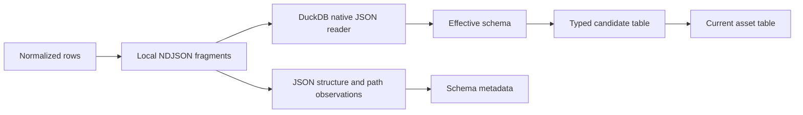

# Schema Inference

Assquack treats source schema as evidence, not as a fixed API contract. Each
materialization records what the source actually returned and combines that
evidence with the latest published schema.

## Inference Flow

Rows are written to bounded local NDJSON fragments before schema decisions are
made. DuckDB's native `read_json` scans the completed fragment set with deep
inference and `union_by_name`, so late fields and differences between fragments
contribute to one run-level schema.

The fragments are a local ingestion and replay surface. They do not determine
asset freshness; the current DuckDB table and Assquack metadata do.

## Schema Observations

Assquack also reads each bounded fragment through DuckDB's JSON tooling:

- `json_group_structure` records its recursive structure;
- `json_tree` records path-level types, presence, and null counts;
- array indexes are normalized so elements contribute to the same path.

Processing observations one fragment at a time keeps the operation bounded.
The merged structure and path evidence are stored in
`assquack_meta.schemas` and `assquack_meta.schema_observations`.

## Effective Schema

The native reader supplies the current run's inferred columns and types.
Assquack merges those with the latest successful schema:

- fields missing from the current run remain as nullable columns;
- compatible numeric types widen;
- incompatible shapes use `VARIANT` rather than a lossy scalar cast;
- existing columns never disappear automatically.

The typed candidate table is built directly from the completed fragments.
Missing historical fields become `NULL`, and generated casts use `try_cast` so
malformed values do not silently redefine the whole asset.

## VARIANT Policy

`VARIANT` remains the durable type for genuinely heterogeneous fields and for
future raw-payload retention policies. It is not the mandatory landing area for
every source row. The local NDJSON fragments are the default ingestion evidence,
while the published DuckDB table remains canonical.

An explicit future policy may retain a whole `_qa_payload VARIANT` or lossless
`_qa_raw_json` column for raw, audit, or replay requirements. That policy stays
outside the asset decorator.

## Related Docs

- [Materialization Lifecycle](materialization-lifecycle.md): how fragments feed
  the candidate and current tables.
- [Storage Model](storage-model.md): where local fragments, DuckDB state, and
  exports live.
- [Configuration](configuration.md): fragment directory and size controls.
- [Exports](exports.md): publication after a successful table commit.
- [Roadmap](roadmap.md): later semi-structured and incremental work.
