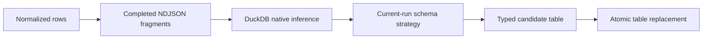

# Schema Inference

Each replacement infers its schema from the current run's completed NDJSON
fragments only. Prior published columns and types do not constrain the new table.

## Inference Flow

DuckDB's native `read_json` scans all completed fragments with full sampling,
`union_by_name`, and nested inference. Late fields and differences between
fragments contribute to one run-level schema. Missing values within the run
become nulls under the inferred schema. Hive partition inference is disabled:
fragment directory labels never add columns or overwrite source fields such as
`asset` and `run_id`.

## Replacement Policy

`AssquackConfig(schema=SchemaConfig(replace="current_run"))` selects the implemented
policy. It is also the default. Use the existing per-call `assquack_config`
override to apply configuration to an individual asset. See
[Configuration](configuration.md#replacement-schema) for an example.

- New source fields appear in the next published table.
- Fields absent from the entire current extraction disappear.
- Types are inferred afresh, including nested objects and arrays.
- An empty extraction publishes zero rows with only `_qa_run_id` and
  `_qa_loaded_at`; historical source columns are not retained.

Downstream queries expecting removed columns can fail. Continuation is future
work and is not an accepted configuration value. The internal strategy protocol
provides the extension point without adding another decorator API.

## Schema Metadata

`assquack_meta.schemas` records the resulting source-column projections for each
candidate run. Successful run status identifies published schemas. The active
flow neither reads historical schemas nor runs `json_group_structure`,
`json_tree`, or detailed field/type observation writes. Existing observation
metadata and internal helpers remain available but are inactive.

## VARIANT Policy

A column inferred as heterogeneous `JSON` becomes durable `VARIANT`. Other
DuckDB-inferred types, including nested structures and lists, are retained.
`VARIANT` is not a mandatory whole-row landing column. NDJSON fragments are local
ingestion evidence; the published DuckDB table remains canonical.

## Related Docs

- [Materialization Lifecycle](materialization-lifecycle.md): candidate creation,
  atomic publication, and failure handling.
- [Storage Model](storage-model.md): fragment and metadata locations.
- [Configuration](configuration.md): schema policy and ingestion settings.
- [Approved MVP scope](journal/2026-09-08-mvp-scope.md): release decisions.
