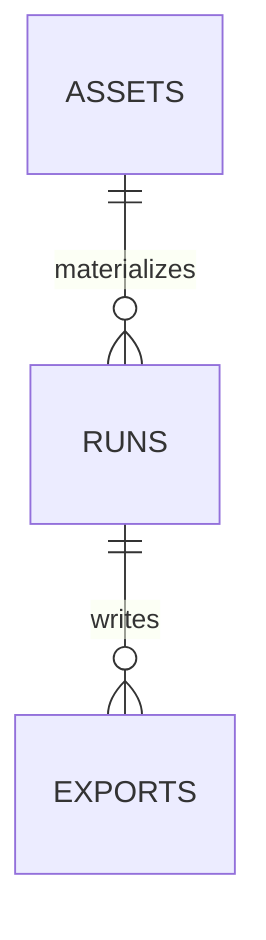

# Assquack Storage Model

Date: 2026-09-10

## Position

Assquack uses embedded DuckDB as its primary storage engine. The MVP write
target is a native `.duckdb` database file on a local writable filesystem path.
Bounded NDJSON fragments live beside the database as local working and diagnostic
evidence while DuckDB builds the typed asset table.

The primary database file is not an object-storage artifact. Do not use ABFSS,
ADLS, or another remote object-store path as the mutable primary location for a
`.duckdb` file. Object storage remains part of the storage architecture for
source reads, Parquet exports, run snapshots, recovery backups, and compatibility
with existing lake conventions.

## Database Path

The zero-configuration database path is relative to the process's current
working directory:

```text
<current-working-directory>/assquack.duckdb
```

`ASSQUACK_HOME` or direct `AssquackConfig` values override that default for
deployments and exceptional runtimes.

Asset authors should not choose database placement in the asset decorator for
the common case. Runtime and project configuration own placement through
`AssquackConfig`, environment variables, or a Hydra adapter.

Example configuration:

```yaml
assquack:
  home: ${oc.env:ASSQUACK_HOME,.}
  database_path: ${assquack.home}/assquack.duckdb
  duckdb:
    temp_directory: ${oc.env:DUCKDB_TEMP_DIRECTORY,${assquack.home}/tmp}
    extensions:
      - json
      - parquet
      - azure
      - postgres
  exports:
    base_uri: abfss://lake/exports/assquack
```

The current-working-directory default requires no runtime configuration.
Deployments must provide writable paths for any configured database home and
DuckDB temp directory. Database placement is not part of the asset identity API.

## Concurrency

A DuckDB database file has one writer at a time. Assquack must enforce this rule
with an Assquack lock keyed by the resolved database path before starting
materialization or modifying canonical tables and metadata.

The lock is an application-level guard around the database file, not a
replacement for DuckDB's own transaction rules. Its responsibilities are:

- serialize write-capable Assquack materializations for the same database path;
- fail or wait predictably when another writer owns the path;
- keep lock ownership independent of asset name, because two assets can share
  one database file;
- allow external orchestrators to add their own concurrency controls without
  becoming core Assquack dependencies.

General queries use read-only transactions on connections with the same access
mode and storage settings as publication connections. This allows retained native
relations to read their snapshots while an asset publishes on another connection
in the same process. The relation and its derivatives keep their connection alive;
DuckDB releases it when those references are reclaimed. Native queries do not take
the materialization lock. Read-only connection mode and other-process writers can
conflict with these retained handles under DuckDB's ordinary file locking rules.
See [query lifetime](developer-api.md#results-and-lifetime).

## Internal Schemas

Assquack reserves the `assquack_meta` schema for system metadata. The distinct
name avoids colliding with the `assquack` catalog that DuckDB derives from the
default `assquack.duckdb` filename. Assquack also reserves a staging schema for
run-local typed candidate tables, recommended as `assquack_stage`. User asset
tables should live in sanitized asset schemas and tables chosen from asset
metadata and bound arguments.

Reserved schema purposes:

```text
assquack_meta   system metadata tables
assquack_stage  typed candidate tables for active runs
<asset_schema>  durable user-facing asset tables and views
```

## System Tables

The MVP metadata catalog is stored inside the same DuckDB database file as the
asset tables. Bootstrap creates the `assquack_meta` schema and the following
tables.



`assquack_meta.assets` is the asset manifest. `assquack_meta.runs` records
materialization attempts and their final status. The published asset table owns
its schema; bootstrap does not create schema-history or observation tables.
Existing tables and records are left untouched.
`assquack_meta.exports` records external
artifacts such as current-state Parquet or run snapshots. `uri` is the logical
target, such as `mad://bronze/orders.parquet`; `resolved_uri` is the concrete
target used by DuckDB; `destination_fingerprint` identifies the resolved
configuration, including captured authentication inputs without storing their
values; `role` distinguishes the default compatibility export
from secondary legacy exports.

These export records remain in DuckDB when an export target or its credentials
change. They therefore need the resolved destination fingerprint as well as the
output path to identify where an export succeeded, even with only one configured
destination. See [why destinations need fingerprints](exports.md#why-destinations-need-fingerprints)
for the distinction between materialization validity and export completion.

Developer-facing docs describe the purpose of these tables. The concrete MVP
DDL belongs to the implementor-facing
[Local DuckDB Core epic](epics/01-mvp/01-local-duckdb-core.md#metadata-table-contracts).

## Asset Tables

Each asset gets a stable `asset_id` derived from the function identity, resolved
asset name, and bound arguments. The public asset name uses explicit `name=`
when supplied; otherwise it resolves the declared table template.
Resolved export destinations, credentials, export base URIs, and database paths
must not change the canonical identity. Assquack uses that identity to
derive or validate:

- the metadata row in `assquack_meta.assets`;
- a sanitized schema name;
- a sanitized table name;
- the current durable asset table;
- staging table names for each run;
- export records and cache state.

The current table is the user-facing table queried by `AssquackResult.query()`
and exported to Parquet when exports are enabled. For MVP `replace` mode,
materialization builds staging tables first, then swaps or replaces the current
table inside a DuckDB transaction.

Near-term modes can reuse the same table model:

- `append` adds rows with run metadata and may expose a current view;
- `merge` requires key columns and upserts into the current table;
- `snapshot` retains historical rows or per-run tables and exposes current or
  latest views.

## Local Fragments And Candidate Tables

Every run writes JSON-shaped source rows to:

```text
<fragment-directory>/asset=<asset-name>/run_id=<run-id>/fragment=<number>.ndjson
```

The fragment directory defaults beside the database. Hive-style path components
keep assets, runs, and fragments identifiable during inspection and recovery.
It is local ingestion storage and never resolves through the asset export alias
or `mad://` adapter. Fragments are completed through atomic rename before
DuckDB reads them, and `ingestion.fragment_target_mb` sets their byte-size target.
Whole records can exceed the target; records are never split between files.

DuckDB's native JSON reader scans the complete fragment set and builds a typed
candidate table in `assquack_stage`. The current asset table is updated only
after the candidate is ready to commit.

`VARIANT` remains available for columns whose values are genuinely
heterogeneous; it is not a mandatory whole-row staging format. The target
fragment retention policy keeps the latest successful run and the latest three
failed runs per asset. Candidate tables are dropped after successful
publication.

## Reserved Metadata Columns

Assquack reserves `_qa_` column names for framework metadata. User asset tables
should include the relevant subset of these columns:

```text
_qa_run_id
_qa_loaded_at
_qa_source_uri
_qa_source_hash
_qa_payload
_qa_raw_json
```

Column meanings:

- `_qa_run_id`: materialization run that loaded the row;
- `_qa_loaded_at`: timestamp when Assquack loaded the row;
- `_qa_source_uri`: optional source URI or export/source reference;
- `_qa_source_hash`: optional hash for source or row provenance;
- `_qa_payload`: optional semi-structured payload, `VARIANT` by default;
- `_qa_raw_json`: optional lossless text retention for explicit audit needs.

`_qa_payload` is an optional durable representation for unknown or volatile
nested payloads. DuckDB's native JSON reader and JSON functions use the local
fragments for schema inference; a whole-row `VARIANT` is not required in every
current table.

## Exports And Object Storage

ADLS and ABFSS paths are export and integration targets, not the mutable primary
database location. Use object storage for:

- current-state Parquet exports;
- run snapshot exports;
- recovery backups of local database files;
- source data reads;
- compatibility with existing datalake conventions.

`assquack_meta.exports` records each exported artifact with its run, asset, logical
URI, resolved URI, destination fingerprint, role, format, row count, optional byte count/hash, options,
and creation timestamp. DuckDB's Azure extension should be the first choice for
`abfss://` reads and writes when available. A filesystem fallback can be added
only where DuckDB's native integration cannot satisfy the deployment target.

## Future Shared Storage

If Assquack needs shared multi-process or multi-host write semantics, the target
future architecture is DuckLake with a PostgreSQL catalog and ADLS-backed data
files. That model keeps DuckDB-compatible table access while moving shared
catalog coordination out of a single mutable `.duckdb` file.

The DuckDB Postgres extension remains useful for reading from or writing to
PostgreSQL sources and sinks. It should not be treated as storing a DuckDB
database inside PostgreSQL.

## Related Docs

- [Configuration](configuration.md): how the database path and DuckDB settings
  are resolved.
- [Developer API](developer-api.md): how declared asset names and paths seed
  identity without exposing storage placement.
- [Materialization Lifecycle](materialization-lifecycle.md): how local fragments
  become a candidate and then the current table.
- [Schema Inference](schema-inference.md): how schema evidence is stored and
  promoted.
- [Exports](exports.md): why object storage is an output surface, not the
  mutable source of truth.
- [Roadmap](roadmap.md): future shared-storage exploration.
